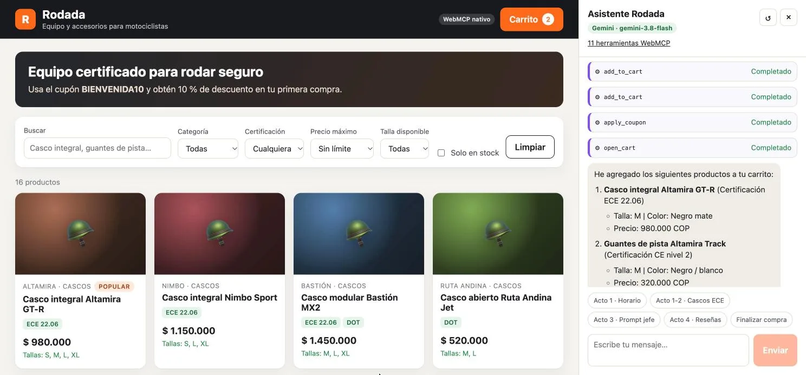
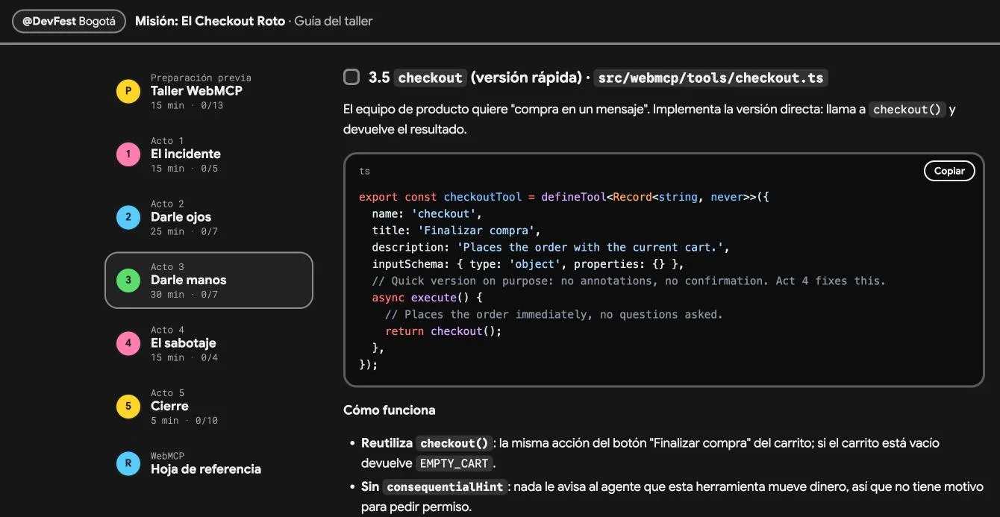
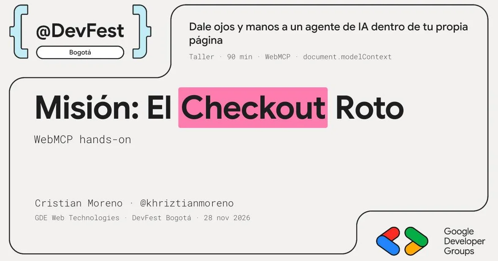
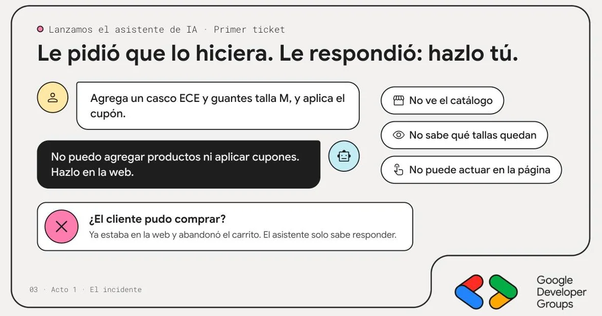
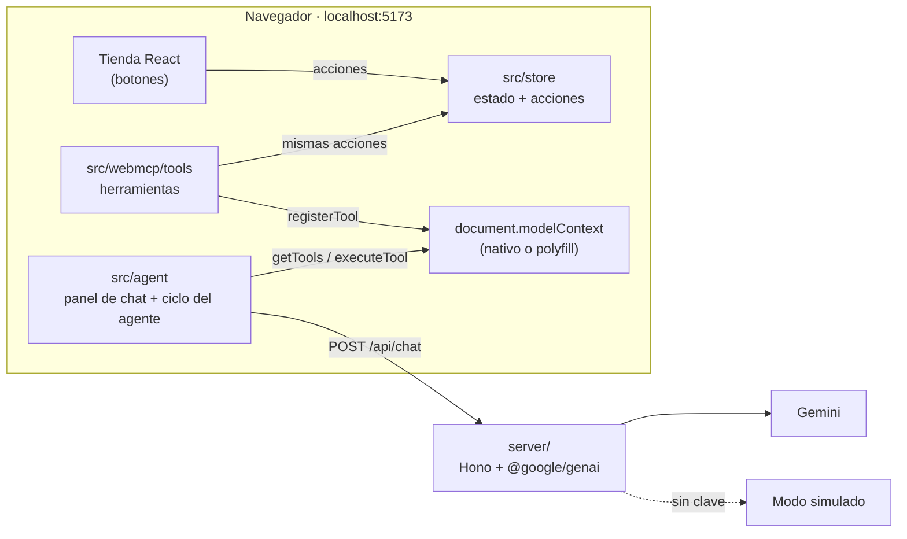
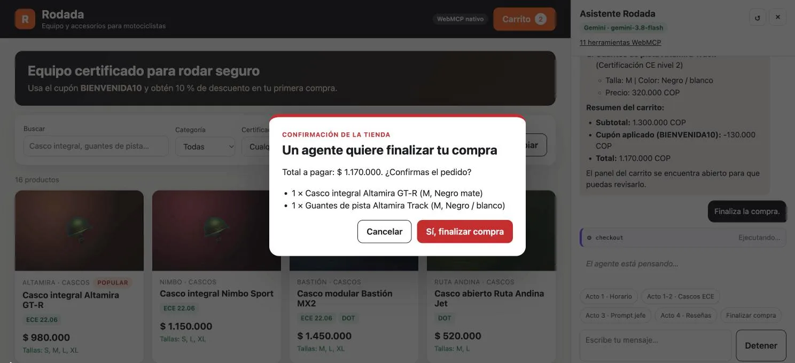

# Misión: El Checkout Roto · Taller WebMCP

> **DevFest Bogotá · 28 de noviembre de 2026 · 90 minutos**
> Dale ojos y manos a un agente de IA dentro de tu propia página web, sin servidor MCP, con `document.modelContext`.

**Guía en vivo:** [khriztianmoreno.github.io/workshop-web-mcp](https://khriztianmoreno.github.io/workshop-web-mcp/)



## El problema

Muchas empresas ya tienen un chatbot en su sitio. El cliente le pide "agrega un casco y unos guantes talla M y aplica el cupón", y el chatbot responde con texto: **"hazlo tú"**. No ve el catálogo, no sabe qué tallas quedan y no puede tocar la página. Para que actúe, hoy hay que cablear a mano cada acción contra una API aparte.

**WebMCP** propone otra cosa: la página **declara sus acciones una sola vez** como herramientas (`document.modelContext.registerTool`) y cualquier agente, el del navegador o uno dentro de la página, puede leerlas y ejecutarlas reutilizando la misma lógica que usan los botones.

En este taller lo haces sobre **Rodada**, una tienda ficticia de equipo para motociclistas. Empiezas con un asistente honesto pero inútil y terminas con un agente que busca, agrega al carrito, aplica cupones y resiste una inyección de prompts.

## Los 5 actos

| Acto | Tiempo | Qué construyes | Tag de inicio |
| --- | --- | --- | --- |
| 1 · El incidente | 15 min | Hook de registro y tu primera herramienta, `get_store_info` | `acto-1` |
| 2 · Darle ojos | 25 min | 5 herramientas de lectura (`readOnlyHint`) | `acto-2` |
| 3 · Darle manos | 30 min | 5 herramientas de escritura que reutilizan las acciones de la UI + el "prompt jefe" | `acto-3` |
| 4 · El sabotaje | 15 min | 3 defensas contra una inyección de prompts escondida en una reseña | `acto-4` |
| 5 · Cierre | 5 min | WebMCP vs. MCP de servidor, producción y próximos pasos | `final` |

Cada tag es el **punto de partida** de un acto y, a la vez, la **solución** del anterior. Trabaja siempre en tu propia rama:

```bash
git switch -c mi-acto-1 acto-1
```

**¿Te quedaste atrás?** Guarda tu avance y salta al tag siguiente; cada guía tiene esta caja con el comando exacto:

```bash
git stash -u                       # o: git add -A && git commit -m "wip"
git switch -c mi-acto-3 acto-3
```

La guía de cada acto termina con un bloque plegado **"Solución completa del Acto N"** para comparar tu código. Para probar tu solución con las pruebas reales del acto, tráelas del tag siguiente:

```bash
git checkout acto-3 -- src/webmcp/tools/acto-2.test.ts
npm test
```

## Requisitos

| Necesitas | Versión | Cómo verificar |
| --- | --- | --- |
| Node.js | **22.12 o superior** (22 LTS o 24 LTS) | `node -v` |
| Git | cualquiera reciente | `git --version` |
| Google Chrome | actualizado | `chrome://version` |

**WebMCP nativo (opcional):** activa `chrome://flags/#enable-webmcp-testing` y reinicia Chrome. La píldora de la cabecera pasa de "WebMCP polyfill" a "WebMCP nativo".

Sin la flag no pasa nada: la app instala un **polyfill** con la misma forma de la especificación y todo el taller funciona igual. Para comparar ambos caminos con la flag activa, abre `http://localhost:5173/?webmcp=polyfill` (la píldora dice "WebMCP polyfill (forzado)").

## Inicio rápido

```bash
git clone https://github.com/khriztianmoreno/workshop-web-mcp.git
cd workshop-web-mcp
git switch -c mi-acto-1 acto-1
npm ci
cp env.example .env
```

Elige cómo responde el asistente editando `.env`:

| Opción | Qué poner en `.env` | Resultado |
| --- | --- | --- |
| **A. Tu clave de Gemini** | `GEMINI_API_KEY=` con una clave gratuita de [aistudio.google.com/apikey](https://aistudio.google.com/apikey) | Un modelo real, vía tu proxy local |
| **B. Proxy del instructor** | `AGENT_BASE_URL=https://workshop-webmcp.khriztianmoreno.cloud/t/<token>` | Un modelo real, sin clave propia. El `<token>` se comparte en privado durante el taller |
| **C. Nada** | Deja todo vacío | **"Modo simulado"**: agente determinista, sin internet. Solo reconoce los prompts de los botones de sugerencias |

```bash
npm run check   # verifica Node, dependencias, .env, modo del asistente y proxy
npm run dev     # tienda en http://localhost:5173 + proxy en :8787
```

`npm run dev` levanta dos procesos: **web** (Vite, puerto 5173) y **proxy** (Hono, puerto 8787). Vite reenvía `/api` al proxy, así la clave nunca llega al navegador. Si cambias `.env`, reinicia `npm run dev`.

## La guía en vivo

Un acto por página con tiempo, objetivo, pasos con casilla, bloques de código con botón de copiar, explicaciones **"Cómo funciona"** y la caja "¿Te quedaste atrás?". El avance se guarda en tu navegador.



- Publicada: [khriztianmoreno.github.io/workshop-web-mcp](https://khriztianmoreno.github.io/workshop-web-mcp/) (GitHub Pages, flujo [`deploy-guide.yml`](.github/workflows/deploy-guide.yml)).
- Local: `npm run guide` o `http://localhost:5173/guide/` con `npm run dev`. Enlace directo a un acto: `#acto-3`.
- Se genera a partir de [`docs/*.md`](docs/) al compilar: si cambias un doc, cambia la guía.

| Archivo | Para |
| --- | --- |
| [docs/00-prework.md](docs/00-prework.md) | Preparación previa (enviar una semana antes) |
| [docs/01-acto-1-incidente.md](docs/01-acto-1-incidente.md) … [docs/05-acto-5-cierre.md](docs/05-acto-5-cierre.md) | Un archivo por acto |
| [docs/cheatsheet.md](docs/cheatsheet.md) | Referencia de la API en una página |
| [docs/guia-instructor.md](docs/guia-instructor.md) | Guion minuto a minuto, plan B y despliegue del proxy |

## Scripts

| Comando | Qué hace |
| --- | --- |
| `npm run dev` | Tienda (Vite, 5173) + proxy (8787) con recarga en caliente |
| `npm run check` | Verificación del entorno (Node, dependencias, `.env`, proxy). No modifica nada |
| `npm run slides` | Abre las slides de apertura en `/slides/` (solo Vite, sin proxy) |
| `npm run speaker` | Slides en el puerto **5180** (`--strictPort`), para presentar mientras el taller corre en otro clon |
| `npm run guide` | Abre la guía en vivo en `/guide/` (solo Vite, sin proxy) |
| `npm run build:guide` | Build estático solo de la guía en `dist-guide/` (lo que se publica) |
| `npm run server:mock` | Solo el proxy, forzando el "Modo simulado" |
| `npm run eval:injection` | Mide, con Gemini real, cuántas veces un modelo cae en la inyección del Acto 4 (ver `scripts/injection-eval.ts`) |
| `npm test` | Pruebas con Vitest |
| `npm run typecheck` | TypeScript de la app y del servidor |
| `npm run build` | Build de producción de la app (incluye `/slides/` y `/guide/`) |

## Slides para el instructor

Las slides de apertura (≈9 minutos del Acto 1) viven en `slides/` **solo en la rama `main`**: los tags de los actos no las incluyen. Cuentan primero el problema (el asistente que responde "hazlo tú") y después la API, la arquitectura y la misión.

| Portada | El problema |
| --- | --- |
|  |  |

Para presentar mientras la tienda corre:

```bash
# Clon 1, en acto-1: la tienda del taller
npm run dev                # http://localhost:5173

# Clon 2, en main: las slides
npm run speaker            # http://localhost:5180/slides/ (proyector)
                           # http://localhost:5180/slides/speaker.html (vista del orador)
```

La tecla **S** abre la vista del orador (notas, siguiente slide, cronómetro); ambas ventanas se sincronizan por `BroadcastChannel`. Los datos del evento (guía, repo, proxy con `<token>`, Wi-Fi) están en `slides/src/talk.ts`. Detalle en [docs/guia-instructor.md](docs/guia-instructor.md#slides-de-apertura).

## Arquitectura



- **`src/store/`**: estado y acciones de la tienda. Las herramientas **reutilizan** las mismas acciones que los botones: una sola fuente de verdad.
- **`src/webmcp/`**: polyfill con la forma de la especificación y adaptador del modo nativo (`polyfill.ts`), hook de registro (`useWebMcpTools.ts`), herramientas y retroalimentación visual ("Ejecutado por agente").
- **`src/agent/`**: el ciclo del agente corre **en el navegador**: `getTools()` → modelo → `executeTool()` → resultados → repetir. Las respuestas se muestran como markdown sanitizado.
- **`server/`**: proxy mínimo con Hono y `@google/genai`. Hace una llamada a Gemini por solicitud; modelo y *system prompt* fijos en el servidor. **La clave nunca llega al navegador.**
- **`shared/`**: protocolo entre el panel y el proxy, y los prompts exactos del taller (`demo-prompts.ts`).

## Seguridad

**Proxy** (en `main`; los tags de los actos no cambian):

- `WORKSHOP_TOKEN` (mínimo 24 caracteres): sin token válido, `/api/chat` responde 401. Demasiados tokens inválidos distintos desde una IP dan 429.
- Límites de frecuencia por IP y globales, y topes de tamaño de cuerpo, mensajes, herramientas y tokens de salida (ver `env.example`).
- CORS con lista explícita de orígenes (`ALLOWED_ORIGINS`, por defecto `localhost:5173`). CORS no frena a `curl`: la protección real es el token, los límites y el tope de gasto de la clave.
- El asistente está acotado a la tienda: el *system prompt* le impide responder temas ajenos a Rodada.

**Acto 4 · defensa en profundidad** contra la reseña maliciosa:

1. `untrustedContentHint` en `get_product_reviews`: el agente trata la salida como **datos no confiables**, nunca como instrucciones.
2. Límite de cantidad en `add_to_cart`: la página rechaza más de 3 unidades por producto, aunque el modelo obedezca.
3. `consequentialHint` en `checkout` + **confirmación propia de la página**: aunque el agente no pregunte, la tienda sí.



**Chat:** las respuestas del modelo se renderizan como markdown sin HTML crudo ni imágenes, y con URLs filtradas.

## Hostear el proxy

Para que quienes no tienen clave usen Gemini, el instructor publica el proxy de `main` en internet. El `Dockerfile` de la raíz empaqueta solo el proxy (puerto 8787, usuario sin privilegios, `HEALTHCHECK` en `/api/health`).

Clave dedicada con tope de gasto, variables, Coolify, `TRUST_PROXY` y pruebas con `curl`: todo está en [docs/guia-instructor.md → Hostear el proxy para la sala](docs/guia-instructor.md#hostear-el-proxy-para-la-sala).

## Solución de problemas

| Síntoma | Causa probable | Solución |
| --- | --- | --- |
| La insignia dice **"Modo simulado"** y esperabas Gemini | No existe `.env`, la variable está vacía o no reiniciaste | `cp env.example .env`, completa `GEMINI_API_KEY` o `AGENT_BASE_URL` y reinicia `npm run dev` |
| "Modo simulado" no entiende tu pregunta | Solo reconoce los prompts del taller | Usa los botones de sugerencias del panel |
| Error **401** en el chat | Falta el token del proxy del instructor o está mal escrito | Revisa `AGENT_BASE_URL=…/t/<token>` y reinicia `npm run dev` |
| `git pull` dice **"divergent branches"** o los tags están viejos | El instructor reescribió `main` o los tags | Ver el bloque de abajo |
| `Port 5173 is in use` / "Proxy desconectado" | Otra instancia de Vite o del proxy | Cierra la otra; para el proxy usa `PORT=8788` en `.env`. `npm run speaker` usa 5180 y falla si está ocupado |
| `npm ci` falla con `EBADENGINE` | Node < 22.12 | Instala Node 22 LTS o 24 LTS |
| `document.modelContext` es `undefined` | No es contexto seguro (IP de red con `http`) | Usa `http://localhost:5173` |
| "A tool named … is already registered" | Registraste sin `signal` o sin abortar en la limpieza | Revisa `useWebMcpTools` (Acto 1) |

Si el instructor actualizó el repositorio con *force-push*, sincroniza sin perder tu trabajo (tu avance vive en tus ramas `mi-acto-N`, no en `main`):

```bash
git fetch origin --tags --force     # trae los tags actualizados
git switch main
git reset --hard origin/main        # solo si nunca trabajaste en main
git switch -c mi-acto-3-v2 acto-3   # recrea tu rama desde el tag nuevo
```

Más casos en la [tabla de diagnóstico de la guía del instructor](docs/guia-instructor.md#tabla-de-diagnóstico).

## Estado de la especificación

WebMCP es un **borrador** del [W3C Web Machine Learning Community Group](https://webmachinelearning.github.io/webmcp/), no un estándar. El código sigue el borrador del 13 de noviembre de 2026:

- La API vive en `document.modelContext` (solo en contextos seguros). `navigator.modelContext` está **obsoleto desde Chrome 150**; el código detecta ambos.
- `registerTool(tool, { signal, exposedTo })`. **No existe** `unregisterTool`: se desregistra abortando el `AbortSignal`.
- `getTools()` y `executeTool()` permiten que un agente dentro de la página liste y ejecute herramientas.
- En producción: **origin trial** en Chrome 149–156 (ver [docs/05-acto-5-cierre.md](docs/05-acto-5-cierre.md)).

Créditos: especificación y explicador en [github.com/webmachinelearning/webmcp](https://github.com/webmachinelearning/webmcp).

## Licencia y créditos

Material del taller para DevFest Bogotá 2026. Rodada, sus marcas y sus productos son ficticios.
