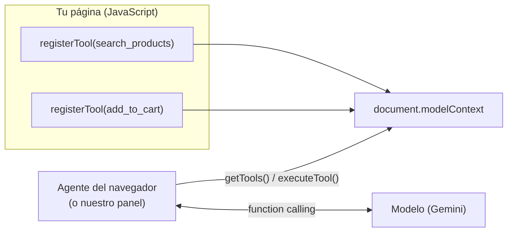

# Acto 1 · El incidente

| Duración | Tag de inicio | Tag de solución |
| --- | --- | --- |
| **15 minutos** (≈9 de slides de apertura + ≈6 de práctica) | `acto-1` | `acto-2` |

**Objetivo:** entender por qué el asistente no puede ayudar a comprar y registrar tu **primera herramienta WebMCP** de forma correcta (con `AbortSignal` y compatible con StrictMode).

---

## La historia

Lunes, 8:12 a. m. Llega un ticket de soporte:

> "Le pedí al asistente que me armara el kit: un casco certificado, guantes de pista en talla M y el cupón de bienvenida. Me respondió que **lo hiciera yo directamente en la página web**. ¡Estaba en la página web! Al final no compré nada."

El asistente funciona: el modelo responde rápido y es honesto. El problema es otro: **no ve ni toca la página**. No sabe qué hay en el catálogo, qué tallas quedan ni cómo agregar algo al carrito. Así que le devuelve el trabajo al cliente ("hazlo tú en la web"), y el cliente abandona el carrito. Es **un asistente honesto pero inútil**.

El arco del taller: en el Acto 1 el mismo pedido termina en "hazlo tú"; en el Acto 2 le das **ojos** y responde con datos reales del catálogo; en el Acto 3 le das **manos** y ese mismo pedido se ejecuta en cascada. WebMCP no cura las alucinaciones: le da al agente ojos y manos.

## 1. Reproduce el incidente (1 min)

```bash
npm run dev
```

**Cómo funciona:** levanta la tienda (Vite, puerto 5173) y el proxy del agente (puerto 8787) en una sola terminal. El panel del asistente le habla al proxy por `/api`, y el proxy le habla al modelo.

1. Abre [http://localhost:5173](http://localhost:5173).
2. En el panel **Asistente Rodada**, haz clic en "0 herramientas WebMCP": la lista está vacía.
3. Envía el pedido del cliente con el botón "Acto 3 · Prompt jefe". Sí, es el botón del Acto 3: es exactamente lo que vas a lograr que ejecute.

```text
Busca un casco certificado por menos de 1.200.000 COP, agrégalo en talla M junto con unos guantes de pista talla M, aplica el cupón de bienvenida y abre el carrito.
```

**Qué ejercita:** un pedido de varios pasos (buscar, filtrar por precio y talla, agregar dos productos, aplicar cupón, abrir el carrito). Sin herramientas, fíjate en que el asistente no puede hacer ninguno.

**Esperado:** una respuesta amable que no hace nada. Con Gemini observamos algo como: "En este momento no dispongo de las herramientas necesarias para consultar el catálogo de la tienda, verificar la disponibilidad de productos ni gestionar el carrito de compras… Por favor, realiza la búsqueda y la compra directamente a través de la página web de Rodada". El cliente ya está en la página y el asistente le dice que lo haga a mano. El carrito sigue vacío.

**Comprobación opcional:** envía también la pregunta del catálogo (botón "Acto 1-2 · Cascos ECE"):

```text
¿Qué cascos certificados ECE 22.06 hay en stock en talla M por menos de 1.200.000?
```

**Qué ejercita:** una pregunta de solo lectura con cuatro filtros (categoría, certificación, talla con stock y precio). Fíjate en si el asistente admite que no ve el catálogo o si inventa productos.

Responde lo mismo: no tiene acceso al catálogo. La respuesta correcta es solo **Casco integral Altamira GT-R, 980.000 COP**. (El Nimbo Sport cumple todo, salvo que la talla M está agotada.) Guárdala para compararla en el Acto 2.

> **Nota:** los modelos varían. Si el tuyo inventa productos o dice que ya agregó algo al carrito, el argumento es aún más fuerte. En ambos casos el punto es el mismo: el asistente no puede ver ni tocar la página.

## 2. El modelo mental (visto en las slides de apertura)

> Queda aquí como referencia: no le dediques tiempo de práctica.

Un **chatbot** solo tiene el texto de la conversación. Un **agente** tiene herramientas. WebMCP permite que **la página** le entregue herramientas al agente que la está usando.



**Qué muestra el diagrama:** la página registra sus herramientas en `document.modelContext`. El agente (el del navegador o nuestro panel) las lista con `getTools()`, se las ofrece al modelo como funciones y, cuando el modelo decide llamar una, la ejecuta con `executeTool()`. El modelo nunca toca la página directamente: siempre pasa por el agente.

Cinco ideas clave:

1. **La página decide qué expone.** No es scraping ni un robot haciendo clic: son funciones con nombre, descripción y esquema JSON.
2. **Las herramientas corren en la página**, con la sesión del usuario y la misma lógica de la UI.
3. **Ciclo de vida con `AbortSignal`.** No existe `unregisterTool()`: abortas la señal y la herramienta desaparece.
4. **Anotaciones** (`readOnlyHint`, `untrustedContentHint`, `consequentialHint`) le dicen al agente cómo tratar cada herramienta.
5. **Eventos**: `toolchange`, `toolactivated` y `toolcancel`. Nuestra app usa `toolactivated` para iluminar lo que toca el agente.

> Detección de la API: `document.modelContext ?? navigator.modelContext`. La segunda está obsoleta desde Chrome 150.

### Experimento rápido en la consola (opcional, 1 min)

Abre DevTools en la tienda y pega:

```js
// The controller owns the tool's lifetime: there is no unregisterTool().
const controller = new AbortController();
await document.modelContext.registerTool(
  {
    name: 'say_hello', // unique id the agent calls
    description: 'Says hello from the page.', // what the model reads to decide when to call it
    // Runs inside the page when an agent calls the tool.
    async execute() {
      return 'Hola desde la página';
    },
  },
  { signal: controller.signal },
);
// Mira el panel: ahora dice "1 herramienta WebMCP".
controller.abort(); // Y vuelve a 0.
```

**Cómo funciona**

- `registerTool(tool, { signal })` publica una función de la página en `document.modelContext`; desde ese momento cualquier agente que lea `getTools()` la ve (por eso el panel pasa a "1 herramienta").
- `name` es el identificador con el que el agente la invoca y `description` es lo único que el modelo lee para decidir cuándo usarla.
- `execute()` corre **dentro de la página**, con su JavaScript y su estado; lo que devuelve es la respuesta que recibe el agente.
- No hay `unregisterTool()`: la herramienta vive mientras su `AbortSignal` no se aborte. `controller.abort()` la retira y el contador vuelve a 0.

## 3. Escribe el hook de registro (3 min)

Archivo: `src/webmcp/useWebMcpTools.ts`

Requisitos:

- Registrar cada herramienta con `document.modelContext.registerTool(tool, { signal })`.
- Un `AbortController` por ejecución del efecto; abortarlo en la limpieza.
- No fallar si la API no existe.

```ts
import { useEffect } from 'react';
import type { ModelContextTool } from './types';

/**
 * Registers WebMCP tools while the component is mounted.
 *
 * - One AbortController per effect run: aborting its signal unregisters every tool
 *   (the spec has no unregisterTool()).
 * - StrictMode-safe: React mounts, cleans up (abort → tools removed) and mounts again,
 *   so names never collide.
 */
export function useWebMcpTools(tools: readonly ModelContextTool[]): void {
  useEffect(() => {
    // document.modelContext is the spec entry point; navigator.modelContext is deprecated (Chrome 150).
    const modelContext = document.modelContext ?? navigator.modelContext;
    // No WebMCP in this browser: do nothing. The page keeps working for humans.
    if (!modelContext) return;

    const controller = new AbortController();
    for (const tool of tools) {
      modelContext.registerTool(tool, { signal: controller.signal }).catch((error: unknown) => {
        // Our own cleanup already aborted this run (e.g. StrictMode's first mount): expected, not a bug.
        if (controller.signal.aborted) return;
        console.error(`[webmcp] Could not register "${tool.name}"`, error);
      });
    }
    // Unmount (or a new `tools` array): one abort unregisters all of this run's tools.
    return () => controller.abort();
    // `tools` must be a stable reference (a module-level array), or every render re-registers.
  }, [tools]);
}
```

**Cómo funciona**

- **`useEffect`**: registrar herramientas es un efecto secundario ligado al ciclo de vida del componente. Se registran al montar y se retiran al desmontar, igual que una suscripción.
- **`document.modelContext ?? navigator.modelContext`**: detección de la API. La especificación la movió a `document`; `navigator.modelContext` sigue existiendo en algunas versiones pero está obsoleto desde Chrome 150. Si ninguna existe, el hook no hace nada y la tienda sigue funcionando para las personas.
- **`AbortController` + `{ signal }`**: la especificación no tiene `unregisterTool()`. Abortar la señal retira la herramienta, y como todas comparten el mismo controlador, un solo `abort()` las retira todas a la vez.
- **`.catch` que ignora errores si `signal.aborted`**: en desarrollo, StrictMode monta, desmonta y vuelve a montar. Si un registro falla porque nuestra propia limpieza ya lo abortó (por ejemplo, un error de nombre duplicado o de registro abortado), es ruido esperado. Cualquier otro error sí se reporta.
- **`return () => controller.abort()`**: la función de limpieza. React la llama al desmontar y antes de volver a ejecutar el efecto, así que nunca quedan dos registros con el mismo nombre.
- **Dependencia `[tools]`**: el efecto se repite cada vez que cambia la **referencia** del arreglo. Por eso `storeTools` se define a nivel de módulo: si lo crearas dentro del componente, cada render retiraría y volvería a registrar todas las herramientas.

**¿Por qué importa StrictMode?** En desarrollo React monta, desmonta y vuelve a montar cada componente. Sin la limpieza, el segundo montaje intentaría registrar `get_store_info` otra vez y la especificación **lanza un error** por nombre duplicado. `src/main.tsx` usa `<StrictMode>` a propósito.

```text
montaje   → registerTool(get_store_info, signal A)     ✔
limpieza  → A.abort()  → la herramienta desaparece      ✔
montaje   → registerTool(get_store_info, signal B)     ✔ (sin duplicado)
```

**Cómo leerlo:** es la secuencia que ejecuta React en desarrollo. Cada montaje crea un `AbortController` nuevo (señales A y B); la limpieza aborta la señal anterior, así que cuando llega el segundo registro el nombre ya está libre.

## 4. Tu primera herramienta: `get_store_info` (2 min)

Archivo: `src/webmcp/tools/get-store-info.ts`

```ts
import { STORE_INFO } from '../../data/products';
import { defineTool } from '../types';

// defineTool() is an identity helper: it only adds type inference for `execute`'s input.
// Record<string, never> = this tool takes no arguments.
export const getStoreInfoTool = defineTool<Record<string, never>>({
  name: 'get_store_info', // snake_case verb: what the agent calls
  title: 'Información de la tienda', // human-facing label (shown in the panel)
  // Written for the model: what it returns, so it knows when to call it.
  description:
    'Returns general information about the Rodada store: opening hours, address, shipping costs and delivery times, free-shipping threshold, payment methods, returns policy and contact.',
  // An empty object schema: the model must send {} and nothing else.
  inputSchema: { type: 'object', properties: {} },
  // Changes nothing, so an agent may call it without asking the user.
  annotations: { readOnlyHint: true },
  async execute() {
    // Same data the store page renders: one source of truth.
    return STORE_INFO;
  },
});
```

**Cómo funciona**

- **`name`, `title` y `description`**: `name` es el identificador que usa el agente; `title` es la etiqueta para personas; `description` es el **único manual** que tiene el modelo, así que se escribe para él: qué devuelve y cuándo conviene usarla.
- **`inputSchema`**: un JSON Schema que el modelo debe llenar al llamar la herramienta. Aquí es un objeto vacío porque no necesita argumentos.
- **`annotations: { readOnlyHint: true }`**: le avisa al agente que la herramienta no cambia nada, así que puede llamarla sin pedir permiso. En el panel aparece como "solo lectura".
- **`execute()`**: corre en la página cuando el agente la invoca. Devuelve `STORE_INFO`, los mismos datos que muestra la interfaz, para que el agente y la pantalla nunca digan cosas distintas.
- **`defineTool()`**: no hace nada en tiempo de ejecución; solo le da a TypeScript el tipo de entrada para que `execute` quede bien tipado.

Luego agrégala a la lista en `src/webmcp/tools/index.ts`:

```ts
import { getStoreInfoTool } from './get-store-info';

// Module-level constant: a stable reference, so useWebMcpTools() registers once.
export const storeTools: readonly ModelContextTool[] = [
  getStoreInfoTool,
  // TODO(acto-2): ...
];
```

**Cómo funciona**

- `storeTools` es la lista que `<App />` le pasa a `useWebMcpTools()`. Una herramienta que no esté aquí no se registra, aunque su archivo exista.
- Se declara a nivel de módulo, fuera de cualquier componente: así su referencia nunca cambia y el efecto `[tools]` no vuelve a registrar en cada render.

> La **descripción** es para el modelo, no para humanos: di qué devuelve y cuándo usarla. La escribimos en inglés porque es parte del contrato técnico; el `title` es la etiqueta visible en español.

## Hito · cómo verificar

1. El panel muestra **"1 herramienta WebMCP"** y, al desplegarla, `get_store_info` con la etiqueta "solo lectura".
2. Envía (botón "Acto 1 · Horario"):

   ```text
   ¿Cuál es el horario de la tienda y cuánto cuesta el envío fuera de Bogotá?
   ```

   **Qué ejercita:** una pregunta que `get_store_info` responde por completo. Fíjate en que el agente llame la herramienta (aparece su tarjeta) en lugar de responder de memoria.

3. **Esperado:**
   - Una tarjeta de herramienta `get_store_info` con estado "Completado".
   - La píldora superior ("WebMCP polyfill") brilla con la insignia **"Ejecutado por agente"**.
   - Respuesta correcta: lunes a sábado de 9:00 a 19:00; envío fuera de Bogotá 18.000 COP (2 a 4 días hábiles).
4. Repite el prompt de los cascos o el pedido del kit: **sigue sin poder consultar el catálogo ni tocar el carrito**. El horario funciona porque ahora existe una herramienta para eso; para lo demás todavía responde que no tiene acceso. Los ojos llegan en el Acto 2 y las manos en el Acto 3.

<details>
<summary>Solución completa del Acto 1</summary>

Aquí está cada archivo del Acto 1, exactamente como queda en el tag `acto-2`, para que puedas copiarlo archivo por archivo. Las explicaciones están en la sección Tareas.

**src/webmcp/useWebMcpTools.ts**

```ts
import { useEffect } from 'react';
import type { ModelContextTool } from './types';

/**
 * Registers WebMCP tools while the component is mounted.
 *
 * - One AbortController per effect run: aborting its signal unregisters every tool
 *   (the spec has no unregisterTool()).
 * - StrictMode-safe: React mounts, cleans up (abort → tools removed) and mounts again,
 *   so names never collide.
 */
export function useWebMcpTools(tools: readonly ModelContextTool[]): void {
  useEffect(() => {
    // document.modelContext is the spec entry point; navigator.modelContext is deprecated (Chrome 150).
    const modelContext = document.modelContext ?? navigator.modelContext;
    // No WebMCP in this browser: do nothing. The page keeps working for humans.
    if (!modelContext) return;

    const controller = new AbortController();
    for (const tool of tools) {
      modelContext.registerTool(tool, { signal: controller.signal }).catch((error: unknown) => {
        // Our own cleanup already aborted this run (e.g. StrictMode's first mount): expected, not a bug.
        if (controller.signal.aborted) return;
        console.error(`[webmcp] Could not register "${tool.name}"`, error);
      });
    }
    // Unmount (or a new `tools` array): one abort unregisters all of this run's tools.
    return () => controller.abort();
    // `tools` must be a stable reference (a module-level array), or every render re-registers.
  }, [tools]);
}
```

**src/webmcp/tools/get-store-info.ts**

```ts
import { STORE_INFO } from '../../data/products';
import { defineTool } from '../types';

export const getStoreInfoTool = defineTool<Record<string, never>>({
  name: 'get_store_info',
  title: 'Información de la tienda',
  description:
    'Returns general information about the Rodada store: opening hours, address, shipping costs and delivery times, free-shipping threshold, payment methods, returns policy and contact.',
  inputSchema: { type: 'object', properties: {} },
  annotations: { readOnlyHint: true },
  async execute() {
    return STORE_INFO;
  },
});
```

**src/webmcp/tools/index.ts**

```ts
import type { ModelContextTool } from '../types';
import { getStoreInfoTool } from './get-store-info';

/** Every tool the store exposes. Registered by useWebMcpTools() in <App />. */
export const storeTools: readonly ModelContextTool[] = [
  // Act 1: first tool
  getStoreInfoTool,
  // TODO(acto-2): searchProductsTool, getProductDetailsTool, getProductReviewsTool, getCartTool, getActiveFiltersTool
  // TODO(acto-3): setFiltersTool, addToCartTool, applyCouponTool, openCartTool, checkoutTool
];
```

**Cómo funciona**

- Es el único punto donde se decide qué expone la tienda: el arreglo se pasa completo a `useWebMcpTools()` desde `<App />`.
- Los `TODO` marcan dónde entrarán las herramientas de los Actos 2 y 3; mientras no estén en la lista, el agente no las ve.

También puedes verla con `git diff acto-1 acto-2 -- src/`.

</details>

## ¿Te quedaste atrás?

```bash
git add -A && git commit -m "wip: acto 1"   # o: git stash -u
git switch -c mi-acto-2 acto-2              # empieza el Acto 2 con la solución del Acto 1
```

**Cómo funciona**

- `git add -A && git commit -m "wip: acto 1"` guarda todo tu trabajo (incluidos archivos nuevos) en tu rama actual, para que no se pierda. La alternativa `git stash -u` lo aparta sin crear un commit (`-u` incluye archivos sin seguimiento); lo recuperas luego con `git stash pop`.
- `git switch -c mi-acto-2 acto-2` crea una rama nueva desde el tag `acto-2`, que contiene la solución del Acto 1. Trabajas en tu rama y el tag queda intacto.

Para validar tu propia solución con las pruebas reales:

```bash
git checkout acto-2 -- src/webmcp/tools/acto-1.test.ts
npm test
```

**Cómo funciona**

- `git checkout acto-2 -- <archivo>` copia **solo ese archivo** desde el tag `acto-2` a tu copia de trabajo, sin cambiar de rama ni tocar tu código. Así traes las pruebas del acto sin traer la solución.
- `npm test` ejecuta Vitest una vez (`vitest run`) contra tu implementación.

## Errores comunes

| Síntoma | Causa | Solución |
| --- | --- | --- |
| `A tool named "get_store_info" is already registered` | Falta `return () => controller.abort()` o no pasaste `signal` | Revisa el hook |
| El panel sigue en "0 herramientas" | No agregaste la herramienta a `storeTools` | `src/webmcp/tools/index.ts` |
| `Invalid tool name` | Espacios o tildes en `name` | Usa `snake_case` sin tildes |
| `needs a description` | La descripción quedó vacía | Escribe una descripción útil para el modelo |
| El agente responde `Error: TODO(acto-1)` | Registraste la herramienta sin implementar `execute` | Completa el paso 4 |
| `document.modelContext` es `undefined` | Abriste la app por IP con `http://` | Usa `http://localhost:5173` |
