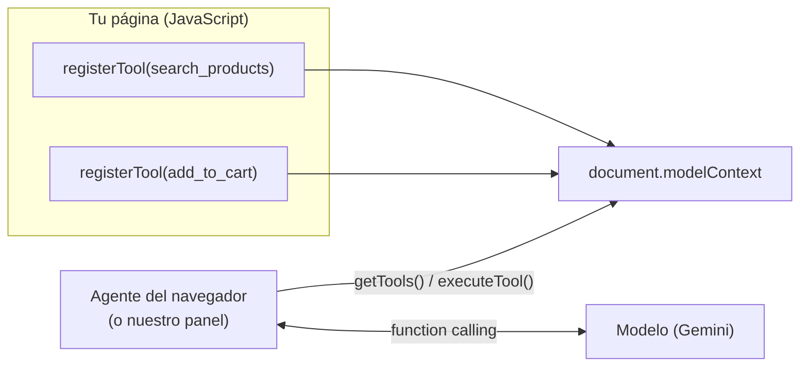

# Acto 1 · El incidente

| Duración | Tag de inicio | Tag de solución |
| --- | --- | --- |
| **15 minutos** | `acto-1` | `acto-2` |

**Objetivo:** entender por qué el asistente inventa y registrar tu **primera herramienta WebMCP** de forma correcta (con `AbortSignal` y compatible con StrictMode).

---

## La historia

Lunes, 8:12 a. m. Llega un ticket de soporte:

> "El asistente de la página me recomendó el **Casco Vulcano Pro** a 890.000 en talla M. Lo busqué y no existe. ¿Me están tomando del pelo?"

El asistente funciona: el modelo responde rápido y con seguridad. El problema es otro: **no ve la página**. No sabe qué hay en el catálogo, qué tallas quedan ni cuánto cuesta el envío. Así que adivina.

## 1. Reproduce el incidente (3 min)

```bash
npm run dev
```

1. Abre [http://localhost:5173](http://localhost:5173).
2. En el panel **Asistente Rodada**, haz clic en "0 herramientas WebMCP": la lista está vacía.
3. Envía este prompt (o usa el botón "Acto 1-2 · Cascos ECE"):

```text
¿Qué cascos certificados ECE 22.06 hay en stock en talla M por menos de 1.200.000?
```

**Esperado:** una respuesta segura y específica… sobre productos que no existen. La respuesta correcta es solo **Casco integral Altamira GT-R, 980.000 COP**. (El Nimbo Sport cumple todo, salvo que la talla M está agotada.)

## 2. El modelo mental (4 min)

Un **chatbot** solo tiene el texto de la conversación. Un **agente** tiene herramientas. WebMCP permite que **la página** le entregue herramientas al agente que la está usando.



Cinco ideas clave:

1. **La página decide qué expone.** No es scraping ni un robot haciendo clic: son funciones con nombre, descripción y esquema JSON.
2. **Las herramientas corren en la página**, con la sesión del usuario y la misma lógica de la UI.
3. **Ciclo de vida con `AbortSignal`.** No existe `unregisterTool()`: abortas la señal y la herramienta desaparece.
4. **Anotaciones** (`readOnlyHint`, `untrustedContentHint`, `consequentialHint`) le dicen al agente cómo tratar cada herramienta.
5. **Eventos**: `toolchange`, `toolactivated` y `toolcancel`. Nuestra app usa `toolactivated` para iluminar lo que toca el agente.

> Detección de la API: `document.modelContext ?? navigator.modelContext`. La segunda está obsoleta desde Chrome 150.

### Experimento rápido en la consola (opcional, 1 min)

Abre DevTools en la tienda y pega:

```js
const controller = new AbortController();
await document.modelContext.registerTool(
  {
    name: 'say_hello',
    description: 'Says hello from the page.',
    async execute() {
      return 'Hola desde la página';
    },
  },
  { signal: controller.signal },
);
// Mira el panel: ahora dice "1 herramienta WebMCP".
controller.abort(); // Y vuelve a 0.
```

## 3. Escribe el hook de registro (4 min)

Archivo: `src/webmcp/useWebMcpTools.ts`

Requisitos:

- Registrar cada herramienta con `document.modelContext.registerTool(tool, { signal })`.
- Un `AbortController` por ejecución del efecto; abortarlo en la limpieza.
- No fallar si la API no existe.

```ts
import { useEffect } from 'react';
import type { ModelContextTool } from './types';

export function useWebMcpTools(tools: readonly ModelContextTool[]): void {
  useEffect(() => {
    const modelContext = document.modelContext ?? navigator.modelContext;
    if (!modelContext) return;

    const controller = new AbortController();
    for (const tool of tools) {
      modelContext.registerTool(tool, { signal: controller.signal }).catch((error: unknown) => {
        if (controller.signal.aborted) return;
        console.error(`[webmcp] Could not register "${tool.name}"`, error);
      });
    }
    return () => controller.abort();
  }, [tools]);
}
```

**¿Por qué importa StrictMode?** En desarrollo React monta, desmonta y vuelve a montar cada componente. Sin la limpieza, el segundo montaje intentaría registrar `get_store_info` otra vez y la especificación **lanza un error** por nombre duplicado. `src/main.tsx` usa `<StrictMode>` a propósito.

```text
montaje   → registerTool(get_store_info, signal A)     ✔
limpieza  → A.abort()  → la herramienta desaparece      ✔
montaje   → registerTool(get_store_info, signal B)     ✔ (sin duplicado)
```

## 4. Tu primera herramienta: `get_store_info` (3 min)

Archivo: `src/webmcp/tools/get-store-info.ts`

```ts
import { STORE_INFO } from '../../data/products';
import { defineTool } from '../types';

export const getStoreInfoTool = defineTool<Record<string, never>>({
  name: 'get_store_info',
  title: 'Información de la tienda',
  description:
    'Returns general information about the Rodada store: opening hours, address, shipping costs and delivery times, free-shipping threshold, payment methods, returns policy and contact.',
  inputSchema: { type: 'object', properties: {} },
  annotations: { readOnlyHint: true },
  async execute() {
    return STORE_INFO;
  },
});
```

Luego agrégala a la lista en `src/webmcp/tools/index.ts`:

```ts
import { getStoreInfoTool } from './get-store-info';

export const storeTools: readonly ModelContextTool[] = [
  getStoreInfoTool,
  // TODO(acto-2): ...
];
```

> La **descripción** es para el modelo, no para humanos: di qué devuelve y cuándo usarla. La escribimos en inglés porque es parte del contrato técnico; el `title` es la etiqueta visible en español.

## Hito · cómo verificar

1. El panel muestra **"1 herramienta WebMCP"** y, al desplegarla, `get_store_info` con la etiqueta "solo lectura".
2. Envía (botón "Acto 1 · Horario"):

   ```text
   ¿Cuál es el horario de la tienda y cuánto cuesta el envío fuera de Bogotá?
   ```

3. **Esperado:**
   - Una tarjeta de herramienta `get_store_info` con estado "Completado".
   - La píldora superior ("WebMCP polyfill") brilla con la insignia **"Ejecutado por agente"**.
   - Respuesta correcta: lunes a sábado de 9:00 a 19:00; envío fuera de Bogotá 18.000 COP (2 a 4 días hábiles).
4. Repite el prompt de los cascos: **sigue inventando**. Eso lo arreglamos en el Acto 2.

<details>
<summary>Solución completa del Acto 1</summary>

`src/webmcp/useWebMcpTools.ts` y `src/webmcp/tools/get-store-info.ts`: exactamente los bloques de las secciones 3 y 4.

`src/webmcp/tools/index.ts`:

```ts
import type { ModelContextTool } from '../types';
import { getStoreInfoTool } from './get-store-info';

export const storeTools: readonly ModelContextTool[] = [
  getStoreInfoTool,
  // TODO(acto-2): searchProductsTool, getProductDetailsTool, getProductReviewsTool, getCartTool, getActiveFiltersTool,
  // TODO(acto-3): setFiltersTool, addToCartTool, applyCouponTool, openCartTool, checkoutTool,
];
```

También puedes verla con `git diff acto-1 acto-2 -- src/`.

</details>

## ¿Te quedaste atrás?

```bash
git add -A && git commit -m "wip: acto 1"   # o: git stash -u
git switch -c mi-acto-2 acto-2              # empieza el Acto 2 con la solución del Acto 1
```

Para validar tu propia solución con las pruebas reales:

```bash
git checkout acto-2 -- src/webmcp/tools/acto-1.test.ts
npm test
```

## Errores comunes

| Síntoma | Causa | Solución |
| --- | --- | --- |
| `A tool named "get_store_info" is already registered` | Falta `return () => controller.abort()` o no pasaste `signal` | Revisa el hook |
| El panel sigue en "0 herramientas" | No agregaste la herramienta a `storeTools` | `src/webmcp/tools/index.ts` |
| `Invalid tool name` | Espacios o tildes en `name` | Usa `snake_case` sin tildes |
| `needs a description` | La descripción quedó vacía | Escribe una descripción útil para el modelo |
| El agente responde `Error: TODO(acto-1)` | Registraste la herramienta sin implementar `execute` | Completa el paso 4 |
| `document.modelContext` es `undefined` | Abriste la app por IP con `http://` | Usa `http://localhost:5173` |
