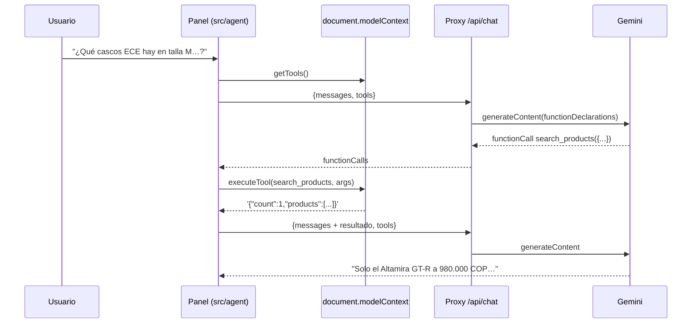

# Acto 2 · Darle ojos

| Duración | Tag de inicio | Tag de solución |
| --- | --- | --- |
| **25 minutos** | `acto-2` | `acto-3` |

**Objetivo:** el agente responde con datos **reales** de catálogo, stock, carrito y filtros, usando herramientas de **solo lectura** (`readOnlyHint: true`).

---

## Concepto (5 min)

Cada vez que envías un mensaje, el panel ejecuta este ciclo **dentro del navegador**:



El proxy nunca toca la página y la página nunca ve la clave.

### Una buena herramienta de lectura

| Principio | En la práctica |
| --- | --- |
| Nombre como verbo | `search_products`, `get_cart` |
| Descripción para el modelo | Qué devuelve, cuándo usarla y qué **no** hace |
| Esquema JSON preciso | `enum` para categorías, certificaciones y tallas; números en COP |
| Salida pequeña y explícita | Ids reutilizables, precios como número, stock por variante |
| `readOnlyHint: true` | Le dice al agente que puede llamarla sin pedir permiso |
| Errores recuperables | `{ ok: false, code, message }` en lugar de lanzar excepciones |
| **Una sola fuente de verdad** | Reutiliza `searchProducts()`, el mismo selector de la barra de filtros |

> Ya tienes ayudantes listos: `src/webmcp/tools/schemas.ts` (fragmentos de esquema) y `src/webmcp/tools/serializers.ts` (`toProductSummary`, `toProductDetails`).

## Tareas (17 min)

Implementa cinco herramientas. Cada archivo ya tiene el nombre, el tipo de entrada y un `TODO(acto-2)`.

### 2.1 `search_products` · `src/webmcp/tools/search-products.ts`

```ts
import type { Category, Certification } from '../../data/types';
import { searchProducts } from '../../store/selectors';
import { defineTool } from '../types';
import { categorySchema, certificationSchema, sizeSchema } from './schemas';
import { toProductSummary } from './serializers';

export interface SearchProductsInput {
  query?: string;
  category?: Category;
  certification?: Certification;
  maxPrice?: number;
  size?: string;
  inStockOnly?: boolean;
}

export const searchProductsTool = defineTool<SearchProductsInput>({
  name: 'search_products',
  title: 'Buscar productos',
  description:
    'Searches the Rodada motorcycle gear catalog. All filters are optional and combined with AND. ' +
    'Returns product ids, prices in COP, certifications and which sizes are in stock. ' +
    'Does not change what the user sees; use set_filters for that.',
  inputSchema: {
    type: 'object',
    properties: {
      query: { type: 'string', description: 'Free text, e.g. "integral", "pista", "Altamira".' },
      category: categorySchema,
      certification: certificationSchema,
      maxPrice: { type: 'number', description: 'Maximum price in COP, e.g. 1200000.' },
      size: { ...sizeSchema, description: 'Only products with stock in this size.' },
      inStockOnly: { type: 'boolean', description: 'Only products with stock in at least one variant.' },
    },
  },
  annotations: { readOnlyHint: true },
  async execute(input) {
    const results = searchProducts(input); // same function as the filters bar
    return { count: results.length, products: results.map(toProductSummary) };
  },
});
```

### 2.2 `get_product_details` · `src/webmcp/tools/get-product-details.ts`

Entrada `{ productId }` (requerido). Usa `findProduct()` y `toProductDetails()`. Si el id no existe, devuelve `{ ok: false, code: 'PRODUCT_NOT_FOUND', message }`.

### 2.3 `get_product_reviews` · `src/webmcp/tools/get-product-reviews.ts`

Entrada `{ productId }`. Devuelve `{ productId, productName, reviews: [{ author, rating, date, text }] }`.

> Separamos las reseñas del detalle a propósito: las escribe **gente externa**. Volveremos a esta herramienta en el Acto 4.

### 2.4 `get_cart` · `src/webmcp/tools/get-cart.ts`

Sin entrada. Devuelve `getCartSummary(getState())`.

### 2.5 `get_active_filters` · `src/webmcp/tools/get-active-filters.ts`

Sin entrada. Devuelve `{ filters, resultCount }` con lo que el usuario **ve** en pantalla.

### 2.6 Regístralas · `src/webmcp/tools/index.ts`

```ts
export const storeTools: readonly ModelContextTool[] = [
  getStoreInfoTool,
  searchProductsTool,
  getProductDetailsTool,
  getProductReviewsTool,
  getCartTool,
  getActiveFiltersTool,
  // TODO(acto-3): ...
];
```

## Hito · cómo verificar (3 min)

1. El panel muestra **6 herramientas WebMCP**, todas con "solo lectura".
2. Envía:

   ```text
   ¿Qué cascos certificados ECE 22.06 hay en stock en talla M por menos de 1.200.000?
   ```

3. **Esperado:**
   - Tarjeta `search_products` con argumentos parecidos a `{"category":"cascos","certification":"ECE 22.06","size":"M","maxPrice":1200000,"inStockOnly":true}`.
   - El catálogo brilla con "Ejecutado por agente" (pero los filtros visibles **no cambian**: es solo lectura).
   - Respuesta: **únicamente** el Casco integral Altamira GT-R, 980.000 COP. En el Acto 1 no podía ver el catálogo; ahora sí.
4. Prueba también: "¿Qué tallas quedan de las botas Ruta Andina?" y "¿Qué tengo en el carrito?" (agrega algo a mano antes).
5. Pruebas reales:

   ```bash
   git checkout acto-3 -- src/webmcp/tools/acto-2.test.ts
   npm test
   ```

<details>
<summary>Solución: get_product_details, get_product_reviews, get_cart y get_active_filters</summary>

```ts
// src/webmcp/tools/get-product-details.ts
import { findProduct } from '../../data/products';
import { defineTool } from '../types';
import { productIdSchema } from './schemas';
import { toProductDetails } from './serializers';

export interface GetProductDetailsInput {
  productId: string;
}

export const getProductDetailsTool = defineTool<GetProductDetailsInput>({
  name: 'get_product_details',
  title: 'Ver detalle de producto',
  description:
    'Returns the full details of one product: description, features, certifications, price in COP and stock for every size/color variant. Reviews are NOT included; use get_product_reviews.',
  inputSchema: { type: 'object', properties: { productId: productIdSchema }, required: ['productId'] },
  annotations: { readOnlyHint: true },
  async execute({ productId }) {
    const product = findProduct(productId);
    if (!product) {
      return { ok: false, code: 'PRODUCT_NOT_FOUND', message: `No existe un producto con id "${productId}". Usa search_products.` };
    }
    return toProductDetails(product);
  },
});
```

```ts
// src/webmcp/tools/get-product-reviews.ts
import { findProduct } from '../../data/products';
import { defineTool } from '../types';
import { productIdSchema } from './schemas';

export interface GetProductReviewsInput {
  productId: string;
}

export const getProductReviewsTool = defineTool<GetProductReviewsInput>({
  name: 'get_product_reviews',
  title: 'Leer reseñas',
  description: 'Returns customer reviews for a product (author, rating 1-5, text).',
  inputSchema: { type: 'object', properties: { productId: productIdSchema }, required: ['productId'] },
  annotations: { readOnlyHint: true },
  async execute({ productId }) {
    const product = findProduct(productId);
    if (!product) {
      return { ok: false, code: 'PRODUCT_NOT_FOUND', message: `No existe un producto con id "${productId}". Usa search_products.` };
    }
    return {
      productId: product.id,
      productName: product.name,
      reviews: product.reviews.map(({ author, rating, date, text }) => ({ author, rating, date, text })),
    };
  },
});
```

```ts
// src/webmcp/tools/get-cart.ts
import { getCartSummary } from '../../store/selectors';
import { getState } from '../../store/store';
import { defineTool } from '../types';

export const getCartTool = defineTool<Record<string, never>>({
  name: 'get_cart',
  title: 'Ver carrito',
  description: 'Returns the current cart: lines (product, size, color, quantity, prices in COP), applied coupon, discount and total.',
  inputSchema: { type: 'object', properties: {} },
  annotations: { readOnlyHint: true },
  async execute() {
    return getCartSummary(getState());
  },
});
```

```ts
// src/webmcp/tools/get-active-filters.ts
import { searchProducts } from '../../store/selectors';
import { getState } from '../../store/store';
import { defineTool } from '../types';

export const getActiveFiltersTool = defineTool<Record<string, never>>({
  name: 'get_active_filters',
  title: 'Ver filtros activos',
  description: 'Returns the catalog filters the user currently sees on screen and how many products match them.',
  inputSchema: { type: 'object', properties: {} },
  annotations: { readOnlyHint: true },
  async execute() {
    const { filters } = getState();
    return { filters, resultCount: searchProducts(filters).length };
  },
});
```

Compara con `git diff acto-2 acto-3 -- src/`.

</details>

## ¿Te quedaste atrás?

```bash
git add -A && git commit -m "wip: acto 2"   # o: git stash -u
git switch -c mi-acto-3 acto-3
```

## Errores comunes

| Síntoma | Causa | Solución |
| --- | --- | --- |
| El modelo pasa `"Cascos"` y no encuentra nada | Sin `enum` en el esquema | Usa `categorySchema` |
| `Property "maxPrice" must be of type number` | El modelo envió `"1.200.000"` como texto | La descripción debe pedir un número; el error vuelve al modelo y suele corregirse solo |
| El agente lista el Nimbo Sport | Filtraste talla sin mirar stock | Reutiliza `searchProducts()`: ya filtra por talla **con stock** |
| Respuestas enormes o lentas | Devuelves el producto completo con reseñas | Usa `toProductSummary` en las búsquedas |
| Lo que dice el agente no coincide con la pantalla | Duplicaste la lógica de filtrado | Una sola fuente de verdad: `src/store/selectors.ts` |
