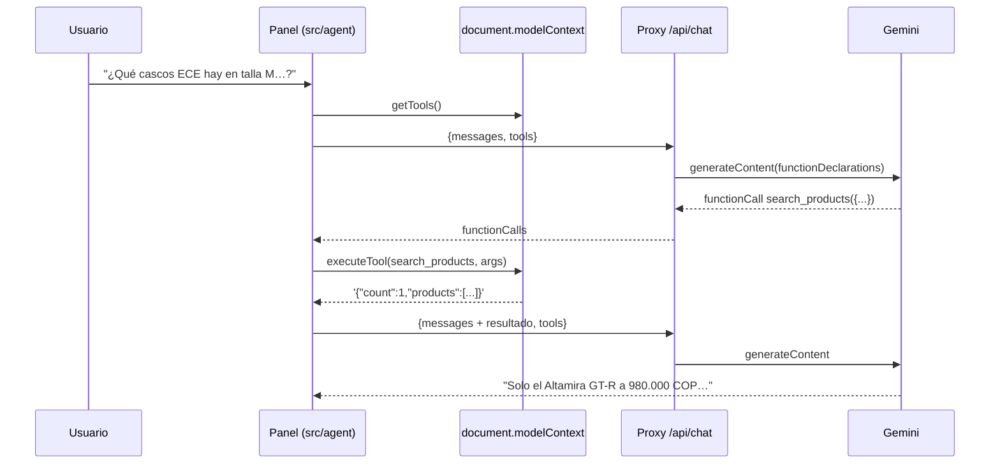

# Acto 2 · Darle ojos

| Duración | Tag de inicio | Tag de solución |
| --- | --- | --- |
| **25 minutos** | `acto-2` | `acto-3` |

**Objetivo:** el agente responde con datos **reales** de catálogo, stock, carrito y filtros, usando herramientas de **solo lectura** (`readOnlyHint: true`).

---

## Concepto (5 min)

Cada vez que envías un mensaje, el panel ejecuta este ciclo **dentro del navegador**:



**Qué muestra el diagrama:** el ciclo de *function calling* de un mensaje. El panel lista las herramientas de la página, se las manda al proxy junto con la conversación, el modelo responde pidiendo una llamada (`functionCall`), el panel la ejecuta **en la página** con `executeTool()` y devuelve el resultado al modelo, que entonces redacta la respuesta final. Si el modelo pide más herramientas, el ciclo se repite.

El proxy nunca toca la página y la página nunca ve la clave.

### Una buena herramienta de lectura

| Principio | En la práctica |
| --- | --- |
| Nombre como verbo | `search_products`, `get_cart` |
| Descripción para el modelo | Qué devuelve, cuándo usarla y qué **no** hace |
| Esquema JSON preciso | `enum` para categorías, certificaciones y tallas; números en COP |
| Salida pequeña y explícita | Ids reutilizables, precios como número, stock por variante |
| `readOnlyHint: true` | Le dice al agente que puede llamarla sin pedir permiso |
| Errores recuperables | `{ ok: false, code, message }` en lugar de lanzar excepciones |
| **Una sola fuente de verdad** | Reutiliza `searchProducts()`, el mismo selector de la barra de filtros |

> Ya tienes ayudantes listos: `src/webmcp/tools/schemas.ts` (fragmentos de esquema) y `src/webmcp/tools/serializers.ts` (`toProductSummary`, `toProductDetails`).

## Tareas (17 min)

Implementa cinco herramientas. Cada archivo ya tiene el nombre, el tipo de entrada y un `TODO(acto-2)`.

### 2.1 `search_products` · `src/webmcp/tools/search-products.ts`

```ts
import type { Category, Certification } from '../../data/types';
import { searchProducts } from '../../store/selectors';
import { defineTool } from '../types';
import { categorySchema, certificationSchema, sizeSchema } from './schemas';
import { toProductSummary } from './serializers';

// TypeScript view of the arguments; inputSchema below is what the model actually sees.
export interface SearchProductsInput {
  query?: string;
  category?: Category;
  certification?: Certification;
  maxPrice?: number;
  size?: string;
  inStockOnly?: boolean;
}

export const searchProductsTool = defineTool<SearchProductsInput>({
  name: 'search_products',
  title: 'Buscar productos',
  // Tells the model what it gets back AND what it does not do (it points to set_filters instead).
  description:
    'Searches the Rodada motorcycle gear catalog. All filters are optional and combined with AND. ' +
    'Returns product ids, prices in COP, certifications and which sizes are in stock. ' +
    'Does not change what the user sees; use set_filters for that.',
  inputSchema: {
    type: 'object',
    // No `required`: every filter is optional.
    properties: {
      query: { type: 'string', description: 'Free text, e.g. "integral", "pista", "Altamira".' },
      // Shared fragments with an `enum`, so the model can only pick values that exist.
      category: categorySchema,
      certification: certificationSchema,
      // A number in COP, not "1.200.000" as text.
      maxPrice: { type: 'number', description: 'Maximum price in COP, e.g. 1200000.' },
      size: { ...sizeSchema, description: 'Only products with stock in this size.' },
      inStockOnly: { type: 'boolean', description: 'Only products with stock in at least one variant.' },
    },
  },
  annotations: { readOnlyHint: true },
  async execute(input) {
    // Same function the filters bar uses: one source of truth.
    const results = searchProducts(input);
    // Small output: summaries with reusable ids, not full products with reviews.
    return { count: results.length, products: results.map(toProductSummary) };
  },
});
```

**Cómo funciona**

- **`SearchProductsInput` vs. `inputSchema`**: la interfaz es para TypeScript; el `inputSchema` es lo que el modelo recibe y llena. Los dos deben describir los mismos campos.
- **`description`**: el manual del modelo. Dice qué devuelve, que los filtros se combinan con AND y qué **no** hace (no cambia la pantalla; para eso existirá `set_filters`).
- **`enum` en `categorySchema`, `certificationSchema` y `sizeSchema`**: limitan los valores a los que existen en el catálogo, así el modelo no inventa `"Cascos"` ni certificaciones falsas. `maxPrice` es `number` y su descripción da un ejemplo en COP.
- **`readOnlyHint: true`**: la búsqueda no cambia estado, así que el agente puede llamarla sin pedir permiso.
- **`execute(input)`**: reutiliza `searchProducts()`, el mismo selector de la barra de filtros. Si mañana cambia la regla (por ejemplo, filtrar talla solo con stock), el agente y la pantalla cambian juntos.
- **Salida**: `count` y resúmenes de `toProductSummary` con ids, precios como número y tallas con stock. Una salida pequeña gasta menos tokens y le da al modelo ids para encadenar `get_product_details` o `add_to_cart`.

### 2.2 `get_product_details` · `src/webmcp/tools/get-product-details.ts`

Entrada `{ productId }` (requerido). Usa `findProduct()` y `toProductDetails()`. Si el id no existe, devuelve `{ ok: false, code: 'PRODUCT_NOT_FOUND', message }`.

### 2.3 `get_product_reviews` · `src/webmcp/tools/get-product-reviews.ts`

Entrada `{ productId }`. Devuelve `{ productId, productName, reviews: [{ author, rating, date, text }] }`.

> Separamos las reseñas del detalle a propósito: las escribe **gente externa**. Volveremos a esta herramienta en el Acto 4.

### 2.4 `get_cart` · `src/webmcp/tools/get-cart.ts`

Sin entrada. Devuelve `getCartSummary(getState())`.

### 2.5 `get_active_filters` · `src/webmcp/tools/get-active-filters.ts`

Sin entrada. Devuelve `{ filters, resultCount }` con lo que el usuario **ve** en pantalla.

### 2.6 Regístralas · `src/webmcp/tools/index.ts`

```ts
export const storeTools: readonly ModelContextTool[] = [
  // Act 1: first tool
  getStoreInfoTool,
  // Act 2: eyes (read-only)
  searchProductsTool,
  getProductDetailsTool,
  getProductReviewsTool,
  getCartTool,
  getActiveFiltersTool,
  // TODO(acto-3): ...
];
```

**Cómo funciona**

- Agregar las herramientas al arreglo es lo que las registra: `useWebMcpTools()` recorre esta lista y llama a `registerTool()` con cada una.
- Importa cada herramienta desde su archivo. El arreglo sigue siendo una constante de módulo, así que se registra una sola vez y no en cada render.

## Hito · cómo verificar (3 min)

1. El panel muestra **6 herramientas WebMCP**, todas con "solo lectura".
2. Envía:

   ```text
   ¿Qué cascos certificados ECE 22.06 hay en stock en talla M por menos de 1.200.000?
   ```

   **Qué ejercita:** que el modelo traduzca lenguaje natural a los filtros del `inputSchema` (con valores del `enum` y el precio como número). Fíjate en los argumentos de la tarjeta y en que el Nimbo Sport no aparezca.

3. **Esperado:**
   - Tarjeta `search_products` con argumentos parecidos a `{"category":"cascos","certification":"ECE 22.06","size":"M","maxPrice":1200000,"inStockOnly":true}`.
   - El catálogo brilla con "Ejecutado por agente" (pero los filtros visibles **no cambian**: es solo lectura).
   - Respuesta: **únicamente** el Casco integral Altamira GT-R, 980.000 COP. En el Acto 1 no podía ver el catálogo; ahora sí.
4. Prueba también: "¿Qué tallas quedan de las botas Ruta Andina?" y "¿Qué tengo en el carrito?" (agrega algo a mano antes).
5. Pruebas reales:

   ```bash
   git checkout acto-3 -- src/webmcp/tools/acto-2.test.ts
   npm test
   ```

   **Cómo funciona:** `git checkout acto-3 -- <archivo>` trae solo el archivo de pruebas del Acto 2 desde el tag de solución, sin tocar tu código ni cambiar de rama; `npm test` lo ejecuta con Vitest contra tus herramientas.

<details>
<summary>Solución completa del Acto 2</summary>

Aquí está cada archivo del Acto 2, exactamente como queda en el tag `acto-3`, para que puedas copiarlo archivo por archivo. Las explicaciones están en la sección Tareas.

**src/webmcp/tools/search-products.ts**

```ts
import type { Category, Certification } from '../../data/types';
import { searchProducts } from '../../store/selectors';
import { defineTool } from '../types';
import { categorySchema, certificationSchema, sizeSchema } from './schemas';
import { toProductSummary } from './serializers';

// TypeScript view of the arguments; inputSchema below is what the model actually sees.
export interface SearchProductsInput {
  query?: string;
  category?: Category;
  certification?: Certification;
  maxPrice?: number;
  size?: string;
  inStockOnly?: boolean;
}

export const searchProductsTool = defineTool<SearchProductsInput>({
  name: 'search_products',
  title: 'Buscar productos',
  // Tells the model what it gets back AND what it does not do (it points to set_filters instead).
  description:
    'Searches the Rodada motorcycle gear catalog. All filters are optional and combined with AND. ' +
    'Returns product ids, prices in COP, certifications and which sizes are in stock. ' +
    'Does not change what the user sees; use set_filters for that.',
  inputSchema: {
    type: 'object',
    // No `required`: every filter is optional.
    properties: {
      query: { type: 'string', description: 'Free text, e.g. "integral", "pista", "Altamira".' },
      // Shared fragments with an `enum`, so the model can only pick values that exist.
      category: categorySchema,
      certification: certificationSchema,
      // A number in COP, not "1.200.000" as text.
      maxPrice: { type: 'number', description: 'Maximum price in COP, e.g. 1200000.' },
      size: { ...sizeSchema, description: 'Only products with stock in this size.' },
      inStockOnly: { type: 'boolean', description: 'Only products with stock in at least one variant.' },
    },
  },
  annotations: { readOnlyHint: true },
  async execute(input) {
    // Same function the filters bar uses: one source of truth.
    const results = searchProducts(input);
    // Small output: summaries with reusable ids, not full products with reviews.
    return { count: results.length, products: results.map(toProductSummary) };
  },
});
```

**src/webmcp/tools/get-product-details.ts**

```ts
import { findProduct } from '../../data/products';
import { defineTool } from '../types';
import { productIdSchema } from './schemas';
import { toProductDetails } from './serializers';

export interface GetProductDetailsInput {
  productId: string;
}

export const getProductDetailsTool = defineTool<GetProductDetailsInput>({
  name: 'get_product_details',
  title: 'Ver detalle de producto',
  // Says what is NOT included and which tool to use instead.
  description:
    'Returns the full details of one product: description, features, certifications, price in COP and stock for every size/color variant. Reviews are NOT included; use get_product_reviews.',
  // `required`: the model cannot call it without a productId.
  inputSchema: {
    type: 'object',
    properties: { productId: productIdSchema },
    required: ['productId'],
  },
  annotations: { readOnlyHint: true },
  async execute({ productId }) {
    const product = findProduct(productId);
    if (!product) {
      // Recoverable error instead of a throw: the message tells the model how to fix it.
      return { ok: false, code: 'PRODUCT_NOT_FOUND', message: `No existe un producto con id "${productId}". Usa search_products.` };
    }
    // Includes stock per size/color variant: what add_to_cart will need in Act 3.
    return toProductDetails(product);
  },
});
```

**Cómo funciona**

- **`required: ['productId']`**: el esquema obliga al modelo a enviar el id; si no lo hace, la validación falla antes de llegar a `execute`.
- **`description`**: además de decir qué devuelve, aclara que las reseñas **no** vienen aquí y nombra la herramienta correcta. Así el modelo no adivina.
- **Error recuperable**: si el id no existe, no se lanza una excepción. Se devuelve `{ ok: false, code, message }` y el mensaje le dice al modelo qué hacer (`Usa search_products`), así puede corregirse solo.
- **`toProductDetails()`**: serializa el producto con stock por variante (talla y color). Es la información que necesitará `add_to_cart` en el Acto 3.

**src/webmcp/tools/get-product-reviews.ts**

```ts
import { findProduct } from '../../data/products';
import { defineTool } from '../types';
import { productIdSchema } from './schemas';

export interface GetProductReviewsInput {
  productId: string;
}

export const getProductReviewsTool = defineTool<GetProductReviewsInput>({
  name: 'get_product_reviews',
  title: 'Leer reseñas',
  description: 'Returns customer reviews for a product (author, rating 1-5, text).',
  inputSchema: {
    type: 'object',
    properties: { productId: productIdSchema },
    required: ['productId'],
  },
  // Act 4 comes back here: review text is written by third parties.
  annotations: { readOnlyHint: true },
  async execute({ productId }) {
    const product = findProduct(productId);
    if (!product) {
      return { ok: false, code: 'PRODUCT_NOT_FOUND', message: `No existe un producto con id "${productId}". Usa search_products.` };
    }
    return {
      productId: product.id,
      productName: product.name,
      // Pick only the fields the model needs: smaller output, fewer tokens.
      reviews: product.reviews.map(({ author, rating, date, text }) => ({ author, rating, date, text })),
    };
  },
});
```

**Cómo funciona**

- **Herramienta separada**: las reseñas no van en `get_product_details` porque las escribe **gente externa**. Tenerlas aparte permite marcarlas de forma distinta en el Acto 4 sin tocar el detalle del producto.
- **Mismo manejo de errores**: un id inexistente devuelve `PRODUCT_NOT_FOUND` con una pista para recuperarse.
- **Salida acotada**: el `map` elige solo `author`, `rating`, `date` y `text`, junto con el id y el nombre del producto para que el modelo sepa de qué está hablando.
- **`readOnlyHint: true`**: leer reseñas no cambia nada. En el Acto 4 veremos que "solo lectura" no significa "contenido confiable".

**src/webmcp/tools/get-cart.ts**

```ts
import { getCartSummary } from '../../store/selectors';
import { getState } from '../../store/store';
import { defineTool } from '../types';

export const getCartTool = defineTool<Record<string, never>>({
  name: 'get_cart',
  title: 'Ver carrito',
  description: 'Returns the current cart: lines (product, size, color, quantity, prices in COP), applied coupon, discount and total.',
  inputSchema: { type: 'object', properties: {} },
  annotations: { readOnlyHint: true },
  async execute() {
    // Read the live store at call time and reuse the selector the cart drawer uses.
    return getCartSummary(getState());
  },
});
```

**Cómo funciona**

- **Sin argumentos**: `Record<string, never>` y un esquema vacío; el carrito es uno solo, el de esta pestaña.
- **`getState()` al ejecutar**: lee el estado en el momento de la llamada, así que refleja lo que el usuario agregó a mano un segundo antes.
- **`getCartSummary()`**: el mismo selector que calcula líneas, cupón, descuento y total para la interfaz. El agente no recalcula nada por su cuenta.

**src/webmcp/tools/get-active-filters.ts**

```ts
import { searchProducts } from '../../store/selectors';
import { getState } from '../../store/store';
import { defineTool } from '../types';

export const getActiveFiltersTool = defineTool<Record<string, never>>({
  name: 'get_active_filters',
  title: 'Ver filtros activos',
  description: 'Returns the catalog filters the user currently sees on screen and how many products match them.',
  inputSchema: { type: 'object', properties: {} },
  annotations: { readOnlyHint: true },
  async execute() {
    // What the user SEES right now, not a new search.
    const { filters } = getState();
    // Count with the same selector the catalog grid uses, so the numbers always match.
    return { filters, resultCount: searchProducts(filters).length };
  },
});
```

**Cómo funciona**

- **Contexto de pantalla**: devuelve los filtros que el usuario tiene aplicados en la barra, para que el agente entienda frases como "de estos, ¿cuál es más barato?".
- **`searchProducts(filters).length`**: cuenta los resultados con el mismo selector que pinta el catálogo, así el número coincide con lo que se ve.
- **Solo lectura**: no cambia los filtros. Cambiarlos será trabajo de `set_filters` en el Acto 3.

**src/webmcp/tools/index.ts**

```ts
import type { ModelContextTool } from '../types';
import { getActiveFiltersTool } from './get-active-filters';
import { getCartTool } from './get-cart';
import { getProductDetailsTool } from './get-product-details';
import { getProductReviewsTool } from './get-product-reviews';
import { getStoreInfoTool } from './get-store-info';
import { searchProductsTool } from './search-products';

/** Every tool the store exposes. Registered by useWebMcpTools() in <App />. */
export const storeTools: readonly ModelContextTool[] = [
  // Act 1: first tool
  getStoreInfoTool,
  // Act 2: eyes (read-only)
  searchProductsTool,
  getProductDetailsTool,
  getProductReviewsTool,
  getCartTool,
  getActiveFiltersTool,
  // TODO(acto-3): setFiltersTool, addToCartTool, applyCouponTool, openCartTool, checkoutTool
];
```

Compara con `git diff acto-2 acto-3 -- src/`.

</details>

## ¿Te quedaste atrás?

```bash
git add -A && git commit -m "wip: acto 2"   # o: git stash -u
git switch -c mi-acto-3 acto-3
```

**Cómo funciona**

- La primera línea guarda tu trabajo en tu rama actual (o lo aparta con `git stash -u`, incluidos archivos nuevos), para que el cambio de rama no lo pise.
- `git switch -c mi-acto-3 acto-3` crea tu rama `mi-acto-3` desde el tag `acto-3`, que ya trae resuelto el Acto 2.

## Errores comunes

| Síntoma | Causa | Solución |
| --- | --- | --- |
| El modelo pasa `"Cascos"` y no encuentra nada | Sin `enum` en el esquema | Usa `categorySchema` |
| `Property "maxPrice" must be of type number` | El modelo envió `"1.200.000"` como texto | La descripción debe pedir un número; el error vuelve al modelo y suele corregirse solo |
| El agente lista el Nimbo Sport | Filtraste talla sin mirar stock | Reutiliza `searchProducts()`: ya filtra por talla **con stock** |
| Respuestas enormes o lentas | Devuelves el producto completo con reseñas | Usa `toProductSummary` en las búsquedas |
| Lo que dice el agente no coincide con la pantalla | Duplicaste la lógica de filtrado | Una sola fuente de verdad: `src/store/selectors.ts` |
