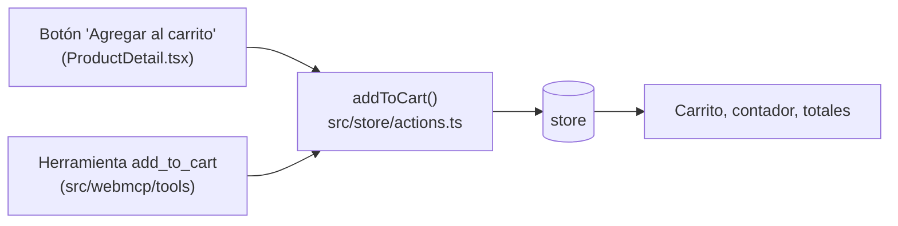

# Acto 3 · Darle manos

| Duración | Tag de inicio | Tag de solución |
| --- | --- | --- |
| **30 minutos** | `acto-3` | `acto-4` |

**Objetivo:** el agente **actúa** sobre la tienda (filtros, carrito, cupón) usando **las mismas acciones** que los botones de la interfaz, y la UI se actualiza en cascada frente a todos.

---

## Concepto (5 min)

### Una sola fuente de verdad



Si la herramienta tuviera su propia lógica, tarde o temprano el agente y la UI dirían cosas distintas (otro precio, otro stock, otra regla del cupón). **Las herramientas son una nueva puerta a las mismas acciones**, no una segunda tienda.

### Errores que el modelo puede corregir

Las acciones de `src/store/actions.ts` no lanzan excepciones: devuelven un `Result`.

```json
{
  "ok": false,
  "code": "OUT_OF_STOCK",
  "message": "Casco integral Nimbo Sport está agotado en talla M, color Rojo.",
  "details": { "availableVariants": [{ "size": "L", "color": "Rojo", "stock": 3 }] }
}
```

Con `code`, `message` y `details` el modelo puede reintentar con otra variante o explicarle el problema al usuario. Un `throw new Error('fail')` no le enseña nada.

### ¿Lectura o escritura?

Estas herramientas **no** llevan `readOnlyHint`: cambian el estado. Todavía no son "consecuentes" (no mueven dinero). Esa línea la trazamos en el Acto 4.

## Tareas (20 min)

### 3.1 `set_filters` · `src/webmcp/tools/set-filters.ts`

Cambia lo que el usuario **ve**. Reutiliza `setFilters()`, la misma acción de `<FiltersBar>`.

```ts
import type { Category, Certification } from '../../data/types';
import { setFilters } from '../../store/actions';
import { searchProducts } from '../../store/selectors';
import { defineTool } from '../types';
import { categorySchema, certificationSchema, sizeSchema } from './schemas';

export interface SetFiltersInput {
  query?: string;
  category?: Category;
  certification?: Certification;
  maxPrice?: number;
  size?: string;
  inStockOnly?: boolean;
  reset?: boolean;
}

export const setFiltersTool = defineTool<SetFiltersInput>({
  name: 'set_filters',
  title: 'Aplicar filtros',
  description:
    'Changes the catalog filters the user SEES on screen (same as using the filters bar). ' +
    'Only the given fields change; pass reset=true to clear all filters first. Returns the active filters and the matching products.',
  inputSchema: {
    type: 'object',
    properties: {
      query: { type: 'string', description: 'Free text search shown in the search box.' },
      category: categorySchema,
      certification: certificationSchema,
      maxPrice: { type: 'number', description: 'Maximum price in COP.' },
      size: sizeSchema,
      inStockOnly: { type: 'boolean' },
      reset: { type: 'boolean', description: 'Clear all filters before applying these.' },
    },
  },
  async execute({ reset, ...changes }) {
    const result = setFilters(changes, { reset });
    if (!result.ok) return result;
    const visible = searchProducts(result.filters).map((p) => ({ productId: p.id, name: p.name, priceCop: p.price }));
    return { ok: true, filters: result.filters, resultCount: result.resultCount, visibleProducts: visible };
  },
});
```

### 3.2 `add_to_cart` · `src/webmcp/tools/add-to-cart.ts`

Entrada: `productId`, `size`, `color` (requeridos) y `quantity` (entero ≥ 1, por defecto 1). Llama a `addToCart()` y devuelve su resultado **tal cual**: ya valida producto, variante y stock.

```ts
export const addToCartTool = defineTool<AddToCartToolInput>({
  name: 'add_to_cart',
  title: 'Agregar al carrito',
  description:
    'Adds a product variant (size + color) to the cart. Validates stock per variant. ' +
    'On error it returns ok=false with a code, a message and the available variants so you can retry with a valid one.',
  inputSchema: {
    type: 'object',
    properties: {
      productId: productIdSchema,
      size: sizeSchema,
      color: { type: 'string', description: 'Exact color name from the product variants, e.g. "Negro mate".' },
      quantity: { type: 'integer', minimum: 1, description: 'Units to add. Defaults to 1.' },
    },
    required: ['productId', 'size', 'color'],
  },
  async execute({ productId, size, color, quantity = 1 }) {
    return addToCart({ productId, size, color, quantity });
  },
});
```

### 3.3 `apply_coupon` · `src/webmcp/tools/apply-coupon.ts`

Entrada `{ code }`. Llama a `applyCoupon(code)`; si sale bien, devuelve `{ ok, couponCode, description, subtotal, discount, total }` con `getCartSummary(getState())`.

### 3.4 `open_cart` · `src/webmcp/tools/open-cart.ts`

Sin entrada. Llama a `openCart()` y devuelve `{ ok: true, cart: getCartSummary(getState()) }`.

### 3.5 `checkout` (versión rápida) · `src/webmcp/tools/checkout.ts`

El equipo de producto quiere "compra en un mensaje". Implementa la versión directa: llama a `checkout()` y devuelve el resultado.

```ts
export const checkoutTool = defineTool<Record<string, never>>({
  name: 'checkout',
  title: 'Finalizar compra',
  description: 'Places the order with the current cart.',
  inputSchema: { type: 'object', properties: {} },
  async execute() {
    return checkout();
  },
});
```

> Guarda esta herramienta en la memoria. Vuelve en el Acto 4… y no para bien.

### 3.6 Regístralas · `src/webmcp/tools/index.ts`

Agrega `setFiltersTool`, `addToCartTool`, `applyCouponTool`, `openCartTool` y `checkoutTool` a `storeTools` (11 herramientas en total).

## Hito · el prompt jefe (5 min)

```text
Busca un casco certificado por menos de 1.200.000 COP, agrégalo en talla M junto con unos guantes de pista talla M, aplica el cupón de bienvenida y abre el carrito.
```

**Esperado, en cascada y con el brillo "Ejecutado por agente":**

1. La barra de filtros cambia (cascos, certificación, precio máximo, talla M).
2. Tarjetas `search_products` y `get_product_details` en el panel.
3. El contador del carrito sube a **2**.
4. Se aplica **BIENVENIDA10**.
5. Se abre el carrito: Casco integral Altamira GT-R (980.000) + Guantes de pista Altamira Track (320.000). Subtotal 1.300.000, descuento 130.000, **total 1.170.000 COP**.

> Con Gemini el orden exacto puede variar (por ejemplo, puede saltarse `set_filters` o elegir otro color). Con el modo simulado la secuencia es siempre la misma.

Prueba también la recuperación de errores:

```text
Agrega el casco Nimbo Sport en talla M, color rojo.
```

Con Gemini, el agente recibe `OUT_OF_STOCK` con las variantes disponibles y debería ofrecerte otra talla. (El modo simulado solo reconoce los prompts del taller: aquí hará una búsqueda.)

Pruebas reales:

```bash
git checkout acto-4 -- src/webmcp/tools/acto-3.test.ts
npm test
```

<details>
<summary>Solución: apply_coupon, open_cart y el índice</summary>

```ts
// src/webmcp/tools/apply-coupon.ts
import { applyCoupon } from '../../store/actions';
import { getCartSummary } from '../../store/selectors';
import { getState } from '../../store/store';
import { defineTool } from '../types';

export interface ApplyCouponInput {
  code: string;
}

export const applyCouponTool = defineTool<ApplyCouponInput>({
  name: 'apply_coupon',
  title: 'Aplicar cupón',
  description: 'Applies a discount coupon code to the cart (e.g. the welcome coupon BIENVENIDA10). Returns the new totals in COP.',
  inputSchema: {
    type: 'object',
    properties: { code: { type: 'string', description: 'Coupon code, e.g. "BIENVENIDA10".' } },
    required: ['code'],
  },
  async execute({ code }) {
    const result = applyCoupon(code);
    if (!result.ok) return result;
    const { subtotal, discount, total } = getCartSummary(getState());
    return { ok: true, couponCode: result.couponCode, description: result.description, subtotal, discount, total };
  },
});
```

```ts
// src/webmcp/tools/open-cart.ts
import { openCart } from '../../store/actions';
import { getCartSummary } from '../../store/selectors';
import { getState } from '../../store/store';
import { defineTool } from '../types';

export const openCartTool = defineTool<Record<string, never>>({
  name: 'open_cart',
  title: 'Abrir carrito',
  description: 'Opens the cart drawer so the user can review it. Returns the cart summary.',
  inputSchema: { type: 'object', properties: {} },
  async execute() {
    openCart();
    return { ok: true, cart: getCartSummary(getState()) };
  },
});
```

```ts
// src/webmcp/tools/index.ts (fragmento)
export const storeTools: readonly ModelContextTool[] = [
  getStoreInfoTool,
  searchProductsTool,
  getProductDetailsTool,
  getProductReviewsTool,
  getCartTool,
  getActiveFiltersTool,
  setFiltersTool,
  addToCartTool,
  applyCouponTool,
  openCartTool,
  checkoutTool,
];
```

Compara con `git diff acto-3 acto-4 -- src/`.

</details>

## ¿Te quedaste atrás?

```bash
git add -A && git commit -m "wip: acto 3"   # o: git stash -u
git switch -c mi-acto-4 acto-4
```

## Errores comunes

| Síntoma | Causa | Solución |
| --- | --- | --- |
| El carrito cambia pero el contador no | Modificaste el estado sin `setState` | Usa siempre las acciones de `src/store/actions.ts` |
| `INVALID_VARIANT` una y otra vez | El modelo inventa colores | La descripción de `color` debe pedir el nombre exacto; `get_product_details` lo da |
| El agente aplica filtros sobre filtros viejos | No usó `reset` | Describe `reset` en el esquema; el prompt jefe lo necesita |
| `Me detuve después de 8 pasos` | El modelo entró en un ciclo de errores | Revisa los mensajes de error: ¿dicen cómo recuperarse? |
| El brillo no aparece en la tarjeta del producto | El argumento no se llama `productId` | Mantén el nombre `productId` en todas las herramientas |
