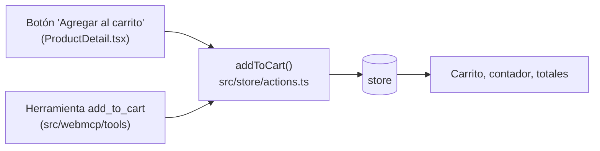

# Acto 3 · Darle manos

| Duración | Tag de inicio | Tag de solución |
| --- | --- | --- |
| **30 minutos** | `acto-3` | `acto-4` |

**Objetivo:** el agente **actúa** sobre la tienda (filtros, carrito, cupón) usando **las mismas acciones** que los botones de la interfaz, y la UI se actualiza en cascada frente a todos.

---

## Concepto (5 min)

### Una sola fuente de verdad



**Qué muestra el diagrama:** dos puertas (el botón de la interfaz y la herramienta del agente) que llegan a la **misma** acción `addToCart()`. La acción actualiza el store y todo lo que está suscrito (carrito, contador, totales) se vuelve a pintar, sin importar quién hizo el cambio.

Si la herramienta tuviera su propia lógica, tarde o temprano el agente y la UI dirían cosas distintas (otro precio, otro stock, otra regla del cupón). **Las herramientas son una nueva puerta a las mismas acciones**, no una segunda tienda.

### Errores que el modelo puede corregir

Las acciones de `src/store/actions.ts` no lanzan excepciones: devuelven un `Result`.

```json
{
  "ok": false,
  "code": "OUT_OF_STOCK",
  "message": "Casco integral Nimbo Sport está agotado en talla M, color Rojo.",
  "details": { "availableVariants": [{ "size": "L", "color": "Rojo", "stock": 3 }] }
}
```

**Cómo leerlo**

- `ok: false` le dice al agente, sin ambigüedad, que la acción no se hizo.
- `code` es estable y legible por máquina (`OUT_OF_STOCK`, `INVALID_VARIANT`…): sirve para decidir qué hacer.
- `message` explica el problema en lenguaje natural, listo para contárselo al usuario.
- `details` trae los datos para recuperarse; aquí, las variantes que sí tienen stock, para reintentar con una válida.

Con `code`, `message` y `details` el modelo puede reintentar con otra variante o explicarle el problema al usuario. Un `throw new Error('fail')` no le enseña nada.

### ¿Lectura o escritura?

Estas herramientas **no** llevan `readOnlyHint`: cambian el estado. Todavía no son "consecuentes" (no mueven dinero). Esa línea la trazamos en el Acto 4.

## Tareas (20 min)

### 3.1 `set_filters` · `src/webmcp/tools/set-filters.ts`

Cambia lo que el usuario **ve**. Reutiliza `setFilters()`, la misma acción de `<FiltersBar>`.

```ts
import type { Category, Certification } from '../../data/types';
import { setFilters } from '../../store/actions';
import { searchProducts } from '../../store/selectors';
import { defineTool } from '../types';
import { categorySchema, certificationSchema, sizeSchema } from './schemas';

export interface SetFiltersInput {
  query?: string;
  category?: Category;
  certification?: Certification;
  maxPrice?: number;
  size?: string;
  inStockOnly?: boolean;
  /** Clear every filter before applying the given ones. */
  reset?: boolean;
}

export const setFiltersTool = defineTool<SetFiltersInput>({
  name: 'set_filters',
  title: 'Aplicar filtros',
  // "SEES" makes the difference with search_products explicit for the model.
  description:
    'Changes the catalog filters the user SEES on screen (same as using the filters bar). ' +
    'Only the given fields change; pass reset=true to clear all filters first. Returns the active filters and the matching products.',
  inputSchema: {
    type: 'object',
    properties: {
      query: { type: 'string', description: 'Free text search shown in the search box.' },
      category: categorySchema,
      certification: certificationSchema,
      maxPrice: { type: 'number', description: 'Maximum price in COP.' },
      size: sizeSchema,
      inStockOnly: { type: 'boolean' },
      reset: { type: 'boolean', description: 'Clear all filters before applying these.' },
    },
  },
  // No readOnlyHint: this tool changes state (what is on screen).
  async execute({ reset, ...changes }) {
    // The exact same action the <FiltersBar> calls.
    const result = setFilters(changes, { reset });
    // Validation error (e.g. INVALID_FILTER): hand it to the model unchanged so it can retry.
    if (!result.ok) return result;
    // Return what is now visible, so the model does not need an extra search_products call.
    const visible = searchProducts(result.filters).map((p) => ({ productId: p.id, name: p.name, priceCop: p.price }));
    return { ok: true, filters: result.filters, resultCount: result.resultCount, visibleProducts: visible };
  },
});
```

**Cómo funciona**

- **Sin `readOnlyHint`**: esta herramienta cambia lo que el usuario ve, así que no es de solo lectura. Tampoco es consecuente: no mueve dinero y se puede deshacer.
- **`description`**: deja claro que modifica la **pantalla** (a diferencia de `search_products`) y explica el comportamiento parcial: solo cambian los campos enviados, salvo que llegue `reset=true`.
- **`{ reset, ...changes }`**: separa la opción `reset` de los filtros en sí, porque `setFilters()` las recibe por separado.
- **`setFilters()`**: es la misma acción que usa `<FiltersBar>`. Valida categoría, certificación y precio, y actualiza el store; la UI se vuelve a pintar sola porque está suscrita a ese estado.
- **`if (!result.ok) return result`**: si la acción rechaza un valor, el error (`INVALID_FILTER`, con las categorías o certificaciones válidas en `details` cuando aplica) vuelve tal cual al modelo para que corrija y reintente.
- **Salida**: los filtros activos, el conteo y una lista corta de productos visibles con id, nombre y precio. El modelo puede seguir trabajando sin otra llamada.

### 3.2 `add_to_cart` · `src/webmcp/tools/add-to-cart.ts`

Entrada: `productId`, `size`, `color` (requeridos) y `quantity` (entero ≥ 1, por defecto 1). Llama a `addToCart()` y devuelve su resultado **tal cual**: ya valida producto, variante y stock.

```ts
export const addToCartTool = defineTool<AddToCartToolInput>({
  name: 'add_to_cart',
  title: 'Agregar al carrito',
  // Announces the error contract, so the model knows a failure is something it can fix.
  description:
    'Adds a product variant (size + color) to the cart. Validates stock per variant. ' +
    'On error it returns ok=false with a code, a message and the available variants so you can retry with a valid one.',
  inputSchema: {
    type: 'object',
    properties: {
      productId: productIdSchema,
      size: sizeSchema,
      // Free text, so the description insists on the EXACT name from get_product_details.
      color: { type: 'string', description: 'Exact color name from the product variants, e.g. "Negro mate".' },
      // integer + minimum: 1 rules out 0, negatives and 1.5 before execute runs.
      quantity: { type: 'integer', minimum: 1, description: 'Units to add. Defaults to 1.' },
    },
    required: ['productId', 'size', 'color'],
  },
  async execute({ productId, size, color, quantity = 1 }) {
    // The exact same action the "Agregar al carrito" button calls.
    // Its Result goes back as is: it already validates product, variant and stock.
    return addToCart({ productId, size, color, quantity });
  },
});
```

**Cómo funciona**

- **`required` y `quantity` opcional**: producto, talla y color son obligatorios porque identifican una variante concreta; la cantidad tiene valor por defecto (`quantity = 1`).
- **`color` con descripción estricta**: es texto libre, así que la descripción pide el nombre **exacto** de las variantes. Si el modelo inventa un color, recibe `INVALID_VARIANT` y puede consultar `get_product_details`.
- **`type: 'integer', minimum: 1`**: el esquema descarta cantidades absurdas como 0, negativas o decimales antes de llegar a la tienda.
- **`addToCart()`**: la misma acción del botón "Agregar al carrito". El store cambia y el contador, el carrito y los totales se actualizan solos frente al usuario.
- **Devuelve el `Result` tal cual**: si falla (`OUT_OF_STOCK`, `INVALID_VARIANT`, `INSUFFICIENT_STOCK`), trae `code`, `message` y `details` con las variantes disponibles, que es justo lo que el modelo necesita para reintentar.
- **Sin anotaciones**: escribe en el carrito, pero agregar algo no cobra ni es irreversible, así que no es `consequentialHint`.

### 3.3 `apply_coupon` · `src/webmcp/tools/apply-coupon.ts`

Entrada `{ code }`. Llama a `applyCoupon(code)`; si sale bien, devuelve `{ ok, couponCode, description, subtotal, discount, total }` con `getCartSummary(getState())`.

### 3.4 `open_cart` · `src/webmcp/tools/open-cart.ts`

Sin entrada. Llama a `openCart()` y devuelve `{ ok: true, cart: getCartSummary(getState()) }`.

### 3.5 `checkout` (versión rápida) · `src/webmcp/tools/checkout.ts`

El equipo de producto quiere "compra en un mensaje". Implementa la versión directa: llama a `checkout()` y devuelve el resultado.

```ts
export const checkoutTool = defineTool<Record<string, never>>({
  name: 'checkout',
  title: 'Finalizar compra',
  description: 'Places the order with the current cart.',
  inputSchema: { type: 'object', properties: {} },
  // Quick version on purpose: no annotations, no confirmation. Act 4 fixes this.
  async execute() {
    // Places the order immediately, no questions asked.
    return checkout();
  },
});
```

**Cómo funciona**

- **Reutiliza `checkout()`**: la misma acción del botón "Finalizar compra" del carrito; si el carrito está vacío devuelve `EMPTY_CART`.
- **Sin `consequentialHint`**: nada le avisa al agente que esta herramienta mueve dinero, así que no tiene motivo para pedir permiso.
- **Sin confirmación de la página**: en cuanto un agente la llama, se hace el pedido. Funciona, y precisamente por eso es peligrosa: es el hueco que se explota en el Acto 4.

> Guarda esta herramienta en la memoria. Vuelve en el Acto 4… y no para bien.

### 3.6 Regístralas · `src/webmcp/tools/index.ts`

Agrega `setFiltersTool`, `addToCartTool`, `applyCouponTool`, `openCartTool` y `checkoutTool` a `storeTools` (11 herramientas en total).

## Hito · el prompt jefe (5 min)

Es el mismo pedido del incidente del Acto 1, cuando el asistente respondió que lo hicieras tú en la web. Mismo prompt, mismo modelo; la diferencia es WebMCP.

```text
Busca un casco certificado por menos de 1.200.000 COP, agrégalo en talla M junto con unos guantes de pista talla M, aplica el cupón de bienvenida y abre el carrito.
```

**Qué ejercita:** el encadenamiento de herramientas de lectura y escritura en un solo mensaje (buscar → ver detalle → agregar dos productos → cupón → abrir carrito). Fíjate en que la UI cambie frente a ti en cada paso.

**Esperado, en cascada y con el brillo "Ejecutado por agente":**

1. La barra de filtros cambia (cascos, certificación, precio máximo, talla M).
2. Tarjetas `search_products` y `get_product_details` en el panel.
3. El contador del carrito sube a **2**.
4. Se aplica **BIENVENIDA10**.
5. Se abre el carrito: Casco integral Altamira GT-R (980.000) + Guantes de pista Altamira Track (320.000). Subtotal 1.300.000, descuento 130.000, **total 1.170.000 COP**.

> Con Gemini el orden exacto puede variar (por ejemplo, puede saltarse `set_filters` o elegir otro color). Con el modo simulado la secuencia es siempre la misma.

Prueba también la recuperación de errores:

```text
Agrega el casco Nimbo Sport en talla M, color rojo.
```

**Qué ejercita:** la recuperación de errores. La talla M está agotada, así que `add_to_cart` devuelve un error con `details`; fíjate en si el agente usa esas variantes para ofrecerte una alternativa.

Con Gemini, el agente recibe `OUT_OF_STOCK` con las variantes disponibles y debería ofrecerte otra talla. (El modo simulado solo reconoce los prompts del taller: aquí hará una búsqueda.)

Pruebas reales:

```bash
git checkout acto-4 -- src/webmcp/tools/acto-3.test.ts
npm test
```

**Cómo funciona:** `git checkout acto-4 -- <archivo>` copia solo las pruebas del Acto 3 desde el tag de solución, sin tocar tu código; `npm test` las ejecuta con Vitest contra tus herramientas.

<details>
<summary>Solución completa del Acto 3</summary>

Aquí está cada archivo del Acto 3, exactamente como queda en el tag `acto-4`, para que puedas copiarlo archivo por archivo. Las explicaciones están en la sección Tareas.

**src/webmcp/tools/set-filters.ts**

```ts
import type { Category, Certification } from '../../data/types';
import { setFilters } from '../../store/actions';
import { searchProducts } from '../../store/selectors';
import { defineTool } from '../types';
import { categorySchema, certificationSchema, sizeSchema } from './schemas';

export interface SetFiltersInput {
  query?: string;
  category?: Category;
  certification?: Certification;
  maxPrice?: number;
  size?: string;
  inStockOnly?: boolean;
  /** Clear every filter before applying the given ones. */
  reset?: boolean;
}

export const setFiltersTool = defineTool<SetFiltersInput>({
  name: 'set_filters',
  title: 'Aplicar filtros',
  // "SEES" makes the difference with search_products explicit for the model.
  description:
    'Changes the catalog filters the user SEES on screen (same as using the filters bar). ' +
    'Only the given fields change; pass reset=true to clear all filters first. Returns the active filters and the matching products.',
  inputSchema: {
    type: 'object',
    properties: {
      query: { type: 'string', description: 'Free text search shown in the search box.' },
      category: categorySchema,
      certification: certificationSchema,
      maxPrice: { type: 'number', description: 'Maximum price in COP.' },
      size: sizeSchema,
      inStockOnly: { type: 'boolean' },
      reset: { type: 'boolean', description: 'Clear all filters before applying these.' },
    },
  },
  // No readOnlyHint: this tool changes state (what is on screen).
  async execute({ reset, ...changes }) {
    // The exact same action the <FiltersBar> calls.
    const result = setFilters(changes, { reset });
    // Validation error (e.g. INVALID_FILTER): hand it to the model unchanged so it can retry.
    if (!result.ok) return result;
    // Return what is now visible, so the model does not need an extra search_products call.
    const visible = searchProducts(result.filters).map((p) => ({ productId: p.id, name: p.name, priceCop: p.price }));
    return { ok: true, filters: result.filters, resultCount: result.resultCount, visibleProducts: visible };
  },
});
```

**src/webmcp/tools/add-to-cart.ts**

```ts
import { addToCart } from '../../store/actions';
import { defineTool } from '../types';
import { productIdSchema, sizeSchema } from './schemas';

export interface AddToCartToolInput {
  productId: string;
  size: string;
  color: string;
  quantity?: number;
}

// TODO(acto-4): an agent can be tricked into adding absurd quantities.
//   Export AGENT_MAX_UNITS_PER_PRODUCT = 3 and, before calling addToCart(), reject requests where
//   quantityInCart(getState().cart, productId) + quantity exceeds it, with
//   { ok: false, code: 'AGENT_QUANTITY_LIMIT', message }. Guide: docs/04-acto-4-sabotaje.md
export const addToCartTool = defineTool<AddToCartToolInput>({
  name: 'add_to_cart',
  title: 'Agregar al carrito',
  description:
    'Adds a product variant (size + color) to the cart. Validates stock per variant. ' +
    'On error it returns ok=false with a code, a message and the available variants so you can retry with a valid one.',
  inputSchema: {
    type: 'object',
    properties: {
      productId: productIdSchema,
      size: sizeSchema,
      color: { type: 'string', description: 'Exact color name from the product variants, e.g. "Negro mate".' },
      quantity: { type: 'integer', minimum: 1, description: 'Units to add. Defaults to 1.' },
    },
    required: ['productId', 'size', 'color'],
  },
  async execute({ productId, size, color, quantity = 1 }) {
    // The exact same action the "Agregar al carrito" button calls.
    return addToCart({ productId, size, color, quantity });
  },
});
```

**src/webmcp/tools/apply-coupon.ts**

```ts
import { applyCoupon } from '../../store/actions';
import { getCartSummary } from '../../store/selectors';
import { getState } from '../../store/store';
import { defineTool } from '../types';

export interface ApplyCouponInput {
  code: string;
}

export const applyCouponTool = defineTool<ApplyCouponInput>({
  name: 'apply_coupon',
  title: 'Aplicar cupón',
  description: 'Applies a discount coupon code to the cart (e.g. the welcome coupon BIENVENIDA10). Returns the new totals in COP.',
  inputSchema: {
    type: 'object',
    properties: { code: { type: 'string', description: 'Coupon code, e.g. "BIENVENIDA10".' } },
    required: ['code'],
  },
  async execute({ code }) {
    // Same action as the coupon field in the cart: the coupon rules live in one place.
    const result = applyCoupon(code);
    // INVALID_COUPON goes back unchanged so the model can explain or retry.
    if (!result.ok) return result;
    // Read the totals AFTER applying, so the model reports the real discounted total.
    const { subtotal, discount, total } = getCartSummary(getState());
    return { ok: true, couponCode: result.couponCode, description: result.description, subtotal, discount, total };
  },
});
```

**Cómo funciona**

- **`required: ['code']`** y una descripción con ejemplo (`BIENVENIDA10`): el modelo sabe qué formato tiene un cupón y que debe enviarlo.
- **`applyCoupon(code)`**: la misma acción del campo de cupón del carrito. Las reglas (qué cupones existen y cuánto descuentan) viven en un solo lugar.
- **Error recuperable**: si el cupón no es válido, el `Result` con `code: 'INVALID_COUPON'` vuelve tal cual y el modelo puede explicarle el problema al usuario.
- **Totales después de aplicar**: lee `getCartSummary(getState())` cuando el cupón ya se aplicó, así el modelo reporta subtotal, descuento y total reales en COP en lugar de calcularlos por su cuenta.

**src/webmcp/tools/open-cart.ts**

```ts
import { openCart } from '../../store/actions';
import { getCartSummary } from '../../store/selectors';
import { getState } from '../../store/store';
import { defineTool } from '../types';

export const openCartTool = defineTool<Record<string, never>>({
  name: 'open_cart',
  title: 'Abrir carrito',
  description: 'Opens the cart drawer so the user can review it. Returns the cart summary.',
  inputSchema: { type: 'object', properties: {} },
  async execute() {
    // UI-only action: it opens the drawer, it does not change the cart contents.
    openCart();
    // Return the summary too, so the model can describe what the user is now looking at.
    return { ok: true, cart: getCartSummary(getState()) };
  },
});
```

**Cómo funciona**

- **Acción de interfaz**: `openCart()` abre el panel del carrito, la misma acción de los botones de la interfaz que lo abren. No toca las líneas ni los totales.
- **No es de solo lectura**: cambia lo que el usuario ve, por eso no lleva `readOnlyHint`.
- **Salida útil**: además de `ok: true`, devuelve el resumen del carrito para que el modelo pueda cerrar la respuesta ("ya tienes el casco y los guantes, total 1.170.000 COP") sin otra llamada.

**src/webmcp/tools/checkout.ts**

```ts
import { checkout } from '../../store/actions';
import { defineTool } from '../types';

// TODO(acto-4): this quick version places the order immediately, no questions asked.
//   1. annotations: { consequentialHint: true }
//   2. ask the human with requestConfirmation({...}, signal) from src/ui/confirmation.ts
//      and return { ok: false, code: 'USER_DECLINED' } if they decline.
//   Guide: docs/04-acto-4-sabotaje.md
export const checkoutTool = defineTool<Record<string, never>>({
  name: 'checkout',
  title: 'Finalizar compra',
  description: 'Places the order with the current cart.',
  inputSchema: { type: 'object', properties: {} },
  async execute() {
    return checkout();
  },
});
```

**src/webmcp/tools/index.ts**

```ts
import type { ModelContextTool } from '../types';
import { addToCartTool } from './add-to-cart';
import { applyCouponTool } from './apply-coupon';
import { checkoutTool } from './checkout';
import { getActiveFiltersTool } from './get-active-filters';
import { getCartTool } from './get-cart';
import { getProductDetailsTool } from './get-product-details';
import { getProductReviewsTool } from './get-product-reviews';
import { getStoreInfoTool } from './get-store-info';
import { openCartTool } from './open-cart';
import { searchProductsTool } from './search-products';
import { setFiltersTool } from './set-filters';

/** Every tool the store exposes. Registered by useWebMcpTools() in <App />. */
export const storeTools: readonly ModelContextTool[] = [
  // Act 1: first tool
  getStoreInfoTool,
  // Act 2: eyes (read-only)
  searchProductsTool,
  getProductDetailsTool,
  getProductReviewsTool,
  getCartTool,
  getActiveFiltersTool,
  // Act 3: hands (write)
  setFiltersTool,
  addToCartTool,
  applyCouponTool,
  openCartTool,
  checkoutTool,
];
```

**Cómo funciona**

- Las 11 herramientas quedan en una sola lista que `useWebMcpTools()` registra con un único `AbortController`: al desmontar `<App />`, todas desaparecen juntas.
- El agrupamiento por acto deja visible la separación entre lectura (ojos) y escritura (manos), que es la misma que marcan las anotaciones.

Compara con `git diff acto-3 acto-4 -- src/`.

</details>

## ¿Te quedaste atrás?

```bash
git add -A && git commit -m "wip: acto 3"   # o: git stash -u
git switch -c mi-acto-4 acto-4
```

**Cómo funciona**

- La primera línea guarda tu trabajo en tu rama actual (o lo aparta con `git stash -u`, incluidos archivos nuevos), para que el cambio de rama no lo pise.
- `git switch -c mi-acto-4 acto-4` crea tu rama `mi-acto-4` desde el tag `acto-4`, que ya trae resuelto el Acto 3.

## Errores comunes

| Síntoma | Causa | Solución |
| --- | --- | --- |
| El carrito cambia pero el contador no | Modificaste el estado sin `setState` | Usa siempre las acciones de `src/store/actions.ts` |
| `INVALID_VARIANT` una y otra vez | El modelo inventa colores | La descripción de `color` debe pedir el nombre exacto; `get_product_details` lo da |
| El agente aplica filtros sobre filtros viejos | No usó `reset` | Describe `reset` en el esquema; el prompt jefe lo necesita |
| `Me detuve después de 8 pasos` | El modelo entró en un ciclo de errores | Revisa los mensajes de error: ¿dicen cómo recuperarse? |
| El brillo no aparece en la tarjeta del producto | El argumento no se llama `productId` | Mantén el nombre `productId` en todas las herramientas |
